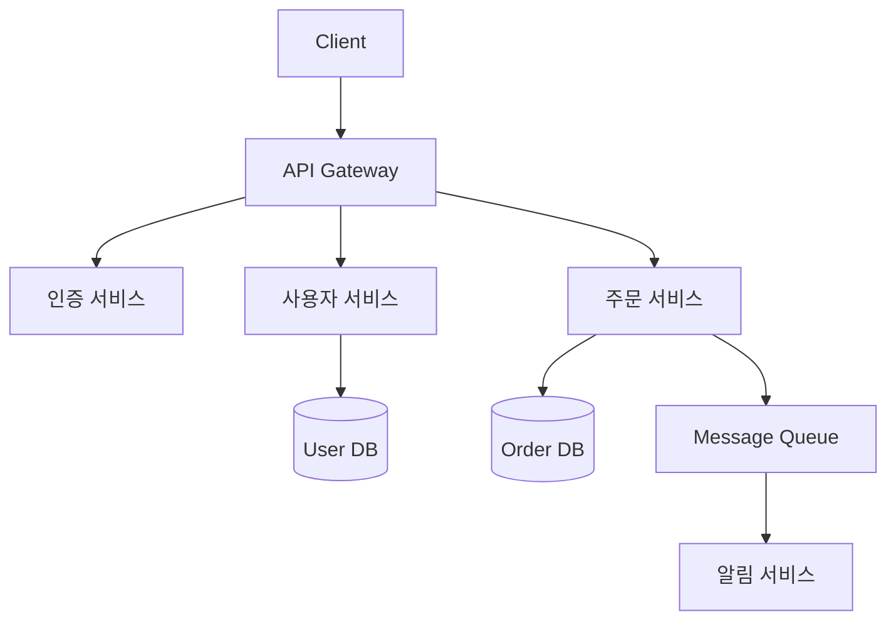

# 🏛️ 아키텍처 및 시스템 설계 (Architecture)

확장 가능하고 유지보수하기 쉬운 시스템을 만들기 위한 **아키텍처 패턴, 시스템 설계 가이드, 핵심 개념** 자료를 수집합니다.

> [!NOTE]
> 대규모 시스템 설계(System Design), 마이크로서비스(MSA), 클라우드 네이티브 아키텍처, 디자인 패턴 등 인프라와 코드를 아우르는 내용을 다룹니다.

---

## 📚 필수 학습 자료 (레퍼런스)

| 이름 (Name) | 링크 (URL) | 한줄 소개 및 추천 이유 |
| :--- | :--- | :--- |
| [System Design Primer](https://github.com/donnemartin/system-design-primer) | https://github.com/donnemartin/system-design-primer | 대규모 시스템 설계 면접 준비 및 실무 적용을 위한 GitHub 최다 스타 저장소 |
| [ByteByteGo](https://bytebytego.com) | https://bytebytego.com | 시스템 설계 개념을 시각적 다이어그램으로 쉽게 설명하는 유료/무료 혼합 플랫폼 |
| [Refactoring Guru - 디자인 패턴](https://refactoring.guru/ko/design-patterns) | https://refactoring.guru/ko/design-patterns | GoF 디자인 패턴 23가지를 한국어로 시각적으로 설명하는 최고의 자료 |
| [Microsoft Azure Architecture Center](https://learn.microsoft.com/ko-kr/azure/architecture) | https://learn.microsoft.com/ko-kr/azure/architecture | 마이크로소프트의 클라우드 아키텍처 베스트 프랙티스 및 레퍼런스 아키텍처 |
| [AWS Architecture Center](https://aws.amazon.com/ko/architecture) | https://aws.amazon.com/ko/architecture | AWS의 공식 아키텍처 레퍼런스와 Well-Architected Framework 가이드 |

---

## 🎯 핵심 아키텍처 패턴

### MSA (Microservices Architecture)

| 패턴 이름 | 설명 | 관련 기술 |
| :--- | :--- | :--- |
| **API Gateway** | 모든 클라이언트 요청의 단일 진입점. 인증, 라우팅, 로드밸런싱 담당 | Kong, AWS API Gateway, Nginx |
| **Circuit Breaker** | 서비스 장애 발생 시 연쇄 장애를 방지하는 패턴 | Resilience4j, Hystrix |
| **Saga Pattern** | MSA에서 분산 트랜잭션을 관리하는 패턴 | Choreography, Orchestration |
| **Event Sourcing** | 상태를 이벤트의 시퀀스로 저장하여 재현 가능하게 만드는 패턴 | Kafka, EventStore |

### 데이터베이스 설계 원칙

| 원칙 | 설명 |
| :--- | :--- |
| **CQRS** | 읽기(Query)와 쓰기(Command) 모델을 분리하여 성능과 확장성 개선 |
| **Database per Service** | MSA에서 각 서비스가 독립적인 DB를 소유하는 원칙 |
| **Sharding** | 데이터를 여러 노드에 수평 분할하여 분산 처리하는 기법 |
| **Read Replica** | 읽기 전용 복제본을 두어 읽기 트래픽을 분산하는 패턴 |

---

## ☁️ 클라우드 아키텍처 주요 개념

| 개념 | 설명 | 학습 링크 |
| :--- | :--- | :--- |
| **서버리스 (Serverless)** | 인프라 관리 없이 코드만 배포하는 방식. 이벤트 기반 실행 | [AWS Lambda 문서](https://docs.aws.amazon.com/ko_kr/lambda) |
| **컨테이너화 (Docker)** | 애플리케이션과 의존성을 컨테이너로 패키징하여 환경 일관성 확보 | [Docker 공식 문서](https://docs.docker.com) |
| **쿠버네티스 (K8s)** | 컨테이너 오케스트레이션 표준. 자동 배포, 스케일링, 자기 치유 | [Kubernetes 공식 문서](https://kubernetes.io/ko/docs) |
| **Service Mesh** | 마이크로서비스 간 통신을 관리하는 인프라 레이어 | [Istio](https://istio.io), [Linkerd](https://linkerd.io) |
| **CDN** | 정적 자산을 전 세계 엣지 서버에 배포하여 지연 시간 최소화 | [Cloudflare](https://cloudflare.com), [AWS CloudFront](https://aws.amazon.com/ko/cloudfront) |

---

## 🔍 아키텍처 설계 원칙 (SOLID + 더 나아가기)

| 원칙 | 약어 | 핵심 내용 |
| :--- | :--- | :--- |
| 단일 책임 원칙 | **S**RP | 클래스/모듈은 하나의 책임만 가져야 한다 |
| 개방-폐쇄 원칙 | **O**CP | 확장에는 열려 있고, 수정에는 닫혀 있어야 한다 |
| 리스코프 치환 원칙 | **L**SP | 자식 클래스는 부모 클래스를 대체할 수 있어야 한다 |
| 인터페이스 분리 원칙 | **I**SP | 사용하지 않는 인터페이스에 의존하지 않아야 한다 |
| 의존 역전 원칙 | **D**IP | 고수준 모듈이 저수준 모듈에 의존하지 않아야 한다 |
| 관심사의 분리 | **SoC** | 각 컴포넌트는 하나의 관심사만 다루어야 한다 |
| DRY | **DRY** | Don't Repeat Yourself. 중복을 제거하라 |
| YAGNI | **YAGNI** | You Aren't Gonna Need It. 필요할 때 만들어라 |

---

## 🛠 추천 아키텍처 도구

| 이름 (Name) | 링크 (URL) | 추천 이유 |
| :--- | :--- | :--- |
| [Excalidraw](https://excalidraw.com) | https://excalidraw.com | 손그림 느낌의 직관적인 화이트보드. 빠른 아이디어 스케치에 최적 |
| [Mermaid Live](https://mermaid.live) | https://mermaid.live | 마크다운 코드로 실시간 다이어그램 생성. GitHub에서 바로 렌더링 |
| [Lucidchart](https://www.lucidchart.com) | https://www.lucidchart.com | 팀 협업이 가능한 전문적인 다이어그램 작성 도구 |
| [C4 Model](https://c4model.com) | https://c4model.com | 소프트웨어 아키텍처를 4가지 레벨(Context→Container→Component→Code)로 표현 |

---

## 📘 아키텍처 관련 필독 서적

- 📖 **클린 아키텍처** (로버트 C. 마틴) - 소프트웨어 아키텍처의 원칙과 철학
- 📖 **가상 면접 사례로 배우는 대규모 시스템 설계 기초** (알렉스 쉬) - 실전 시스템 설계
- 📖 **디자인 패턴** (GoF) - 소프트웨어 설계 패턴의 바이블
- 📖 **마이크로서비스 패턴** (크리스 리처드슨) - MSA 실무 적용 가이드

---

## ✍️ 기여 방법 (How to Contribute)

새로운 아키텍처 자료나 패턴을 알고 계신가요?
1. 이 `README.md`의 적절한 섹션에 내용을 추가해 주세요.
2. Mermaid 다이어그램을 활용하면 더욱 풍부한 문서가 됩니다.
