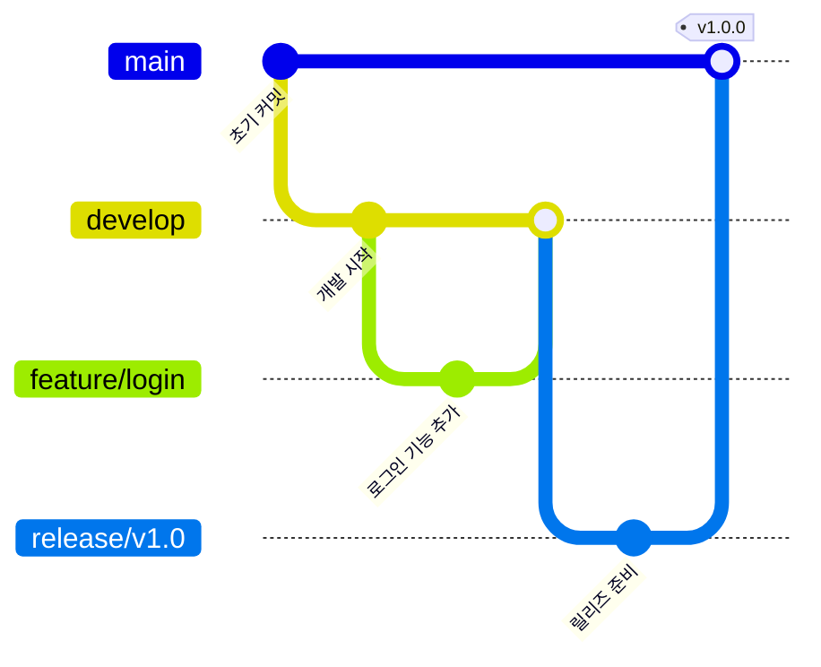

# ✅ 베스트 프랙티스 (Best Practices)

코드 품질을 높이고 팀 협업을 원활하게 하기 위한 **클린 코드, 코딩 컨벤션, 방법론** 자료를 수집합니다.

> [!IMPORTANT]
> 단순한 "잘 짜는 방법"을 넘어, 팀 전체의 개발 문화와 워크플로우를 개선하는 실무 지침을 다룹니다.

---

## 💻 코드 품질 원칙

### 클린 코드 핵심 규칙

| 원칙 | 나쁜 예 (Bad) | 좋은 예 (Good) |
| :--- | :--- | :--- |
| **명확한 네이밍** | `let d = 7;` | `let daysInWeek = 7;` |
| **함수는 하나만** | 조회 + 저장 + 알림을 한 함수에 | 각각 독립적인 함수로 분리 |
| **매직 넘버 제거** | `if (status === 3)` | `if (status === OrderStatus.SHIPPED)` |
| **중복 제거 (DRY)** | 동일 로직 복붙 | 공통 함수/모듈로 추출 |
| **조기 반환** | 깊게 중첩된 if-else | Guard Clause로 조기 반환 |

### 함수 설계 원칙
```javascript
// ❌ Bad: 하나의 함수가 너무 많은 일을 함
async function processUser(userId) {
  const user = await db.find(userId);
  if (user.age < 18) return null;
  user.lastLogin = new Date();
  await db.save(user);
  await emailService.send(user.email, '로그인 알림');
  return user;
}

// ✅ Good: 각 역할을 분리
async function processUser(userId) {
  const user = await findUser(userId);
  if (!isEligible(user)) return null;
  await updateLastLogin(user);
  await notifyLogin(user);
  return user;
}
```

---

## 🌿 Git 브랜치 전략

### Git Flow 전략



| 브랜치 | 역할 | 규칙 |
| :--- | :--- | :--- |
| `main` | 프로덕션 배포 | 직접 커밋 금지. PR 후 병합 |
| `develop` | 개발 통합 | feature 브랜치 병합 대상 |
| `feature/*` | 기능 개발 | `feature/기능명` 형식 사용 |
| `fix/*` | 버그 수정 | `fix/이슈-설명` 형식 사용 |
| `hotfix/*` | 긴급 수정 | main에서 분기, main/develop 동시 병합 |

---

## 📝 커밋 메시지 규칙 (Conventional Commits)

### 형식
```
<타입>(<범위>): <한국어 설명>

[선택] 본문 상세 설명

[선택] 참조: Closes #이슈번호
```

### 커밋 타입 정의
| 타입 | 사용 시점 | 예시 |
| :--- | :--- | :--- |
| `feat` | 새 기능 추가 | `feat(auth): 소셜 로그인 기능 추가` |
| `fix` | 버그 수정 | `fix(api): 토큰 만료 처리 오류 수정` |
| `docs` | 문서 수정 | `docs(readme): 설치 방법 업데이트` |
| `refactor` | 리팩토링 | `refactor(user): 서비스 레이어 분리` |
| `test` | 테스트 추가/수정 | `test(auth): 로그인 엣지 케이스 테스트 추가` |
| `chore` | 빌드/배포 설정 | `chore(ci): GitHub Actions 워크플로우 추가` |
| `perf` | 성능 개선 | `perf(db): 쿼리 인덱스 최적화` |
| `style` | 코드 스타일 | `style: ESLint 규칙 적용` |

---

## 🧪 테스팅 전략

### 테스트 피라미드
```
         /\
        /  \       E2E 테스트 (느림, 비용 높음)
       /----\      통합 테스트 (중간)
      /------\     단위 테스트 (빠름, 비용 낮음)
     /--------\
```

| 테스트 종류 | 도구 (JS/TS) | 도구 (Java) | 도구 (Python) |
| :--- | :--- | :--- | :--- |
| **단위 테스트** | Jest, Vitest | JUnit 5, Mockito | pytest |
| **통합 테스트** | Supertest | Spring Test | pytest + httpx |
| **E2E 테스트** | Playwright, Cypress | Selenium | Playwright |

### 테스트 작성 원칙 (FIRST)
- **F**ast: 테스트는 빠르게 실행되어야 한다
- **I**ndependent: 테스트 간 의존성이 없어야 한다
- **R**epeatable: 어느 환경에서나 동일한 결과가 나와야 한다
- **S**elf-Validating: 명확한 Pass/Fail 판단이 있어야 한다
- **T**imely: 코드 작성 전 또는 직후에 테스트를 작성한다

---

## 🔒 보안 베스트 프랙티스

| 항목 | 설명 |
| :--- | :--- |
| **환경변수 관리** | API 키, DB 패스워드 등 민감정보는 절대 코드에 하드코딩 금지. `.env` 사용 |
| **SQL Injection 방지** | ORM 또는 Prepared Statement 사용. 원시 쿼리에 사용자 입력 직접 삽입 금지 |
| **XSS 방지** | 사용자 입력 데이터는 반드시 이스케이프 처리 또는 DOMPurify 라이브러리 활용 |
| **인증/인가** | JWT는 `httpOnly` 쿠키에 저장. `Authorization` 헤더에 토큰 노출 최소화 |
| **의존성 취약점** | `npm audit`, Dependabot, Snyk 등으로 주기적으로 취약한 라이브러리 점검 |
| **HTTPS** | 모든 통신은 HTTPS 강제 적용. HTTP → HTTPS 자동 리다이렉트 설정 |

---

## 📊 코드 리뷰 체크리스트

> [!TIP]
> PR을 올리기 전에 스스로 아래 항목을 먼저 확인해 보세요.

- [ ] 코드가 요구사항을 모두 충족하는가?
- [ ] 예외 처리 및 에러 핸들링이 적절한가?
- [ ] 단위 테스트가 작성되어 있는가? (커버리지 80% 이상 권장)
- [ ] 민감한 정보(비밀번호, API 키)가 코드에 포함되지 않았는가?
- [ ] 불필요한 주석, 콘솔 로그, 디버깅 코드가 제거되었는가?
- [ ] PR 설명에 변경 이유, 주요 변경 사항, 테스트 방법이 기술되어 있는가?
- [ ] 로컬에서 실행하여 정상 동작을 확인했는가?

---

## 🌐 관련 유용한 자료

| 이름 (Name) | 링크 (URL) | 추천 이유 |
| :--- | :--- | :--- |
| [Google Engineering Practices](https://google.github.io/eng-practices) | https://google.github.io/eng-practices | 구글의 코드 리뷰 가이드. PR 작성자와 리뷰어 양쪽의 관점을 모두 다룸 |
| [Conventional Commits](https://www.conventionalcommits.org/ko/v1.0.0) | https://www.conventionalcommits.org/ko/v1.0.0 | 커밋 메시지 규칙의 표준. 한국어 지원 |
| [The Twelve-Factor App](https://12factor.net/ko) | https://12factor.net/ko | 현대적인 웹 앱을 구축하기 위한 12가지 방법론 |
| [OWASP Top 10](https://owasp.org/www-project-top-ten) | https://owasp.org/www-project-top-ten | 웹 애플리케이션의 10가지 주요 보안 위협 및 대응 방법 |
| [Semantic Versioning](https://semver.org/lang/ko) | https://semver.org/lang/ko | `MAJOR.MINOR.PATCH` 버전 관리 규칙. 한국어 공식 번역 제공 |

---

## ✍️ 기여 방법 (How to Contribute)

새로운 베스트 프랙티스 자료를 알고 계신가요?
1. 이 `README.md`의 적절한 섹션에 내용을 추가해 주세요.
2. 실제 팀에서 적용하고 효과를 검증한 사례 위주로 추가해 주시면 더욱 좋습니다.
