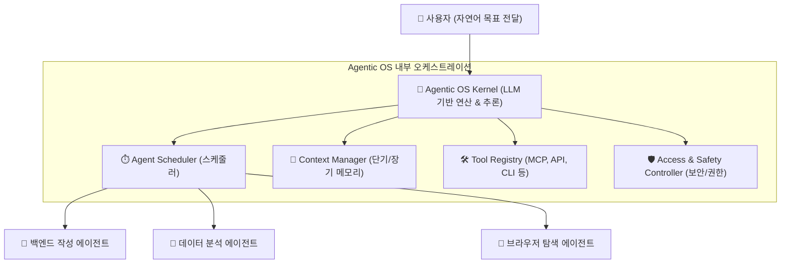

# 🤖 Agentic OS (AI 에이전트 운영체제) 가이드

> **"컴퓨팅의 패러다임이 '명령어 실행'에서 'AI 에이전트 추론 및 오케스트레이션'으로 전환되고 있습니다."**  
> 본 가이드는 Agentic OS(LLM Agent Operating System)의 개념, 필요성, 내부 아키텍처, 기존 OS와의 차이점을 초보 개발자와 일반 개발자 모두 쉽게 이해할 수 있도록 공식 논문 및 기술 자료를 기반으로 정리한 문서입니다.

---

## 💡 1. Agentic OS란 무엇인가요?

### 💻 비유로 이해하는 Agentic OS
- **기존 운영체제 (Windows, macOS, Linux):**  
  CPU와 메모리를 관리하며, 사용자가 **직접 클릭하거나 명령어를 입력(Code/CLI)**해야 소프트웨어가 정해진 수순대로 실행됩니다.
- **Agentic OS (에이전트형 OS):**  
  **LLM(대규모 언어 모델)이 CPU(연산 중앙 장치) 역할**을 수행합니다. 사용자가 **자연어로 목표(Intent)만 전달**하면, OS 내부의 AI 에이전트들이 스스로 실행 계획을 수립하고, 필요한 도구(API, 웹, DB, 터미널)를 호출하며, 메모리를 관리하여 최종 결과를 완성합니다.

---

## ⚡ 2. 왜 Agentic OS가 필요한가요?

기존에는 single-prompt 챗봇이나 단일 LLM API 호출만으로 충분했지만, **여러 AI 에이전트가 동시에 복잡한 작업을 수행하는 멀티 에이전트 시대**가 오면서 다음과 같은 문제점들이 발생했습니다.

1. **자원 경합 및 병목 현상:** 여러 에이전트가 동시에 LLM API를 요청할 때 토큰 비용, 속도 제한(Rate Limit), GPU 자원 조율 필요.
2. **컨텍스트(Context) 낭비:** 제한된 컨텍스트 윈도우(Context Window)로 인해 기억 손실 또는 메모리 초과 발생.
3. **도구(Tool) 및 권한 관리 부재:** 에이전트가 파일 시스템, 데이터베이스, 외부 API에 접근할 때 안전한 격리 환경(Sandbox)과 권한 통제 필요.
4. **에이전트 간 협업 표준 부재:** 각 에이전트 간 메세지 전달 및 업무 분담 규칙 통합 필요.

👉 **Agentic OS는 이러한 문제들을 해결하기 위해 LLM과 하드웨어/외부 도구 사이에서 리소스 스케줄링, 메모리 관리, 안전한 권한 제어를 제공하는 표준 운영 레이어입니다.**

---

## ⚖️ 3. 기존 OS vs Agentic OS 비교

| 구분 | 기존 운영체제 (Traditional OS) | Agentic OS (LLM Agent OS) |
| :--- | :--- | :--- |
| **핵심 연산 장치 (Brain)** | CPU / GPU (진행 명령 집합 처리) | **LLM / SLM (자연어 추론 및 판단)** |
| **주기억 장치 (RAM)** | Physical RAM (DRAM) | **Context Window (컨텍스트 메모리)** |
| **입출력 (I/O)** | 키보드, 마우스, 디스플레이, NVMe | **Tools, APIs, Web Browser, MCP Servers** |
| **프로그래밍 방식** | C, C++, Rust, Python 등 결정론적 코드 | **System Prompts, Natural Language, Function Calling** |
| **동시성 관리 (Concurrency)** | Process & Thread Scheduling | **Agent Request Scheduling & Context Sliding** |
| **사용자 인터페이스 (UI/UX)** | GUI (Windows, App), CLI | **LUI (Language User Interface) & Autonomous Agents** |

---

## 🏗️ 4. Agentic OS의 핵심 구성 요소 (Architecture)

공식 학술 논문인 **AIOS (LLM Agent Operating System)** 아키텍처를 바탕으로 분석한 핵심 모듈입니다.

### 1) AIOS Kernel (에이전트 커널)
- **Agent Scheduler:** 여러 에이전트의 LLM 요청 우선순위를 부여하고, GPU/API 대기열을 효율적으로 배치합니다.
- **Context Manager:** 에이전트별 대화 이력 및 상태를 슬라이딩 윈도우, 백터 DB 요약 기술 등을 활용해 효과적으로 압축/복원합니다.
- **Memory Manager:** 단기 기억(Working Memory)과 장기 기억(Vector Store / Knowledge Base)을 분리 관리합니다.

### 2) Tool & I/O Manager (도구 관리자)
- 에이전트가 웹 검색, 코드 실행(Python/Bash), 파일 I/O, 데이터베이스 쿼리, MCP(Model Context Protocol) 등을 안전하게 실행할 수 있도록 인터페이스를 제공합니다.

### 3) Access & Security Controller (보안 및 권한 제어)
- 에이전트가 무단으로 시스템 자원을 변경하거나 데이터 위험을 유발하지 않도록 격리(Sandboxing)하고, 필요 시 Human-in-the-Loop (인간 사용자 승인) 과정을 거치도록 강제합니다.

---

## 🚀 5. 주요 선도 연구 및 오픈소스 프로젝트

### 1️⃣ Andrej Karpathy의 `LLM OS` 비전
- OpenAI 출신 연구자 Andrej Karpathy가 제안한 개념으로, **"LLM은 단순한 챗봇이 아니라 새로운 컴퓨팅 패러다임의 CPU이다"**라는 비전을 제시했습니다.
- LLM이 사용자 요청을 해석하고, RAM 역할을 하는 Context Window와 I/O 역할을 하는 웹/도구를 연결하는 구조를 명확히 설명했습니다.

### 2️⃣ AIOS: LLM Agent Operating System (AGI Research)
- **COLM 2025** 국제 학술대회에 채택된 대표적인 오픈소스 Agentic OS 연구 프로젝트입니다.
- LLM 커널 수준에서 에이전트 동시 실행 스케줄링, 메모리 관리, SDK를 제공합니다.

### 3️⃣ Open Interpreter & 01 Light
- 로컬 컴퓨터 환경에서 자연어로 쉘 명령, 파일 편집, 웹 브라우징을 자유롭게 실행하는 오픈소스 에이전트 실행 환경입니다.

### 4️⃣ Frameworks (LangGraph, AutoGen, CrewAI, TaskWeaver)
- 완전한 OS 형태 외에도 애플리케이션 개발자가 멀티 에이전트 오케스트레이션을 쉽게 구축할 수 있도록 돕는 에이전트 런타임 프레임워크들입니다.

---

## 📚 6. 참고 사이트 및 공식 문헌

Agentic OS에 대해 더 깊이 탐구하고 싶다면 아래 공식 자료를 참고하세요!

- 📄 **AIOS 공식 연구 논문 (arXiv:2403.16971):**  
  [AIOS: LLM Agent Operating System (arXiv)](https://arxiv.org/abs/2403.16971)
- 🐙 **AIOS 공식 GitHub 저장소:**  
  [agiresearch/AIOS (GitHub)](https://github.com/agiresearch/AIOS)
- 🌐 **AIOS 공식 웹사이트:**  
  [AIOS Foundation](https://aios.foundation/)
- 🎥 **Andrej Karpathy의 LLM OS 설명 아티클 & 영상:**  
  [Intro to Large Language Models (YouTube)](https://www.youtube.com/watch?v=zjkBMFhNj_g)
- 💻 **Open Interpreter (자연어 OS 제어 도구):**  
  [Open Interpreter 공식 저장소](https://github.com/KillianLucas/open-interpreter)
- 🔗 **Anthropic Model Context Protocol (MCP) 명세:**  
  [Model Context Protocol (MCP)](https://modelcontextprotocol.io/)

---

> 💡 **한 줄 요약:**  
> **Agentic OS는 LLM을 CPU 삼아 여러 AI 에이전트의 실행, 메모리, 도구, 보안을 지능적으로 스케줄링하고 오케스트레이션하는 차세대 컴퓨팅 플랫폼입니다.**
