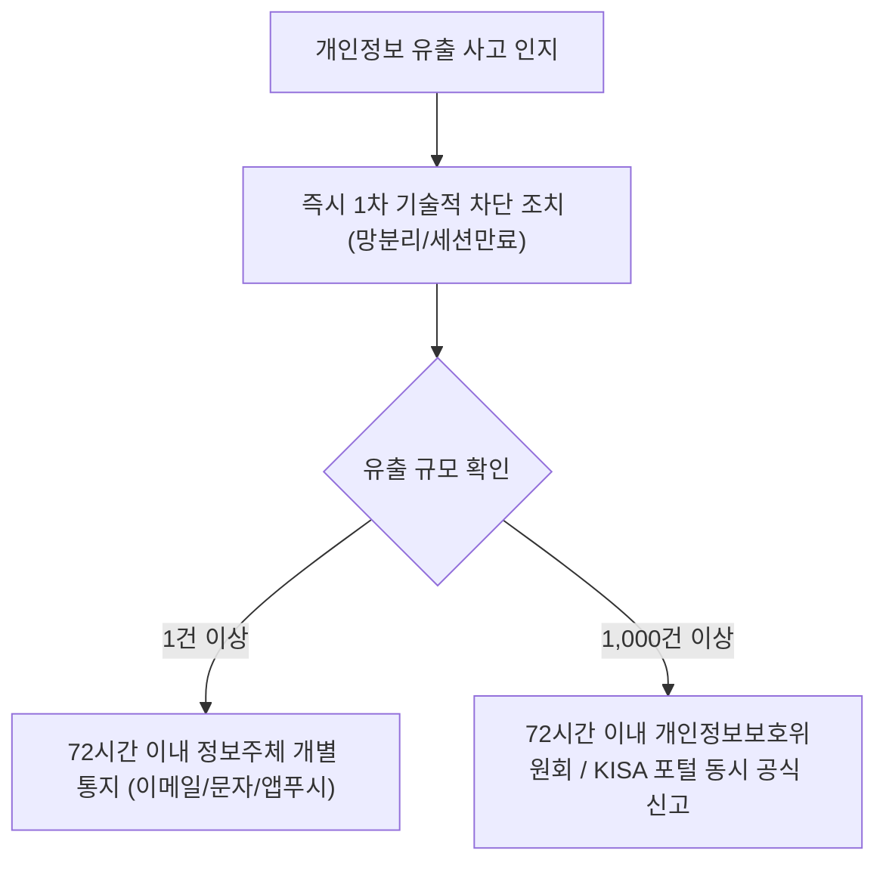

# 🛡️ 개인정보보호 및 데이터 규제

> [!WARNING]
> **⚖️ 법적 면책 고지**: 본 문서는 개발자 및 개인정보보호책임자(CPO), 보안 엔지니어를 위한 기술적·관리적 가이드이며 법률 자문을 대체하지 않습니다. 구체적인 조문 및 고시 기준은 개인정보보호위원회([pipc.go.kr](https://www.pipc.go.kr))의 최신 지침을 확인하십시오.  
> **🌐 주요 관할권**: 🇰🇷 대한민국 개인정보보호법(PIPA), 🇪🇺 유럽연합 GDPR, 🇺🇸 미국 캘리포니아주 CCPA/CPRA

---

## 1. 대한민국 개인정보보호법(PIPA) 핵심 개정 체계 🇰🇷

### 📌 3대 핵심 신설 권리 및 규제
1. **개인정보 전송요구권 (전 분야 마이데이터 확대 시행)**:
   - 금융·공공 분야에 국한되었던 마이데이터 제도가 통신, 유통, 의료 등 전 산업 분야로 전면 확대되었습니다.
   - 이용자가 본인의 개인정보를 본인 또는 지정한 제3자(타 서비스 제공자)에게 **기계 판독이 가능한 형식(JSON, 표준 REST API)**으로 직접 전송하도록 요구할 수 있는 법적 권리입니다.
2. **자동화된 결정에 대한 거부·설명요구권 (제37조의2)**:
   - 인공지능(AI), 알고리즘 등 자동화된 시스템이 처리한 결정(채용 탈락, 대출 거절, 신용등급 강등 등)이 정보주체의 권리·의무에 중대한 영향을 미치는 경우, 정보주체는 해당 결정을 **거부하거나 설명을 요구**할 수 있습니다.
   - **엔지니어링 의무**: 서비스 제공자는 AI 모델의 판단 기준, 사용된 주요 데이터 항목, 논리적 처리 과정을 이용자에게 알기 쉽게 설명할 수 있는 체계(Explainable AI)를 갖추어야 합니다.
3. **과징금 부과 기준 개편 (전체 매출액의 3% 이하)**:
   - 기존의 '위반행위 관련 매출액의 3%'에서 **'위반행위와 관련 없는 매출액을 제외한 전체 매출액의 3% 이하'**로 변경되었습니다. 위반행위와 무관한 매출액에 대한 입증 책임은 기업에 있습니다.

---

## 2. 개인정보의 국외 이전 요건 (제28조의8) 🇰🇷

해외 클라우드 인프라(AWS, GCP, Azure 리전)를 활용하거나 해외 SaaS(GitHub, Slack, Zendesk 등)에 데이터를 위탁할 때 반드시 다음 요건 중 하나를 충족해야 합니다:

```
[국외 이전 가능 4대 요건]
1. 정보주체의 개별적이고 명시적인 사전 동의
2. 계약의 체결 및 이행을 위해 불가피한 경우 (처리위탁/보관 계약 및 보호조치 이행 후 처리방침 공개)
3. 개인정보보호위원회가 지정한 적정성 인정 국가/지역 (EU 적정성 결정 등)
4. 개인정보보호위원회가 정한 국내외 표준 보안 인증(ISMS-P, CBPR 등) 취득
```

> **중지 명령권**: 국외 이전 대상국의 법제도가 미흡하여 이용자 권리 침해가 우려될 경우, 개인정보보호위원회가 국외 이전 중지를 명령할 수 있습니다.

---

## 3. GDPR (EU 일반정보보호규정) 핵심 실무 요건 🇪🇺

- **역외 적용 (Article 3)**: EU 내에 현지 법인이 없더라도, EU 거주자를 대상으로 한국어/영어로 유료 서비스를 판매하거나 쿠키/SDK로 트래킹하는 모든 글로벌 서비스에 적용됩니다.
- **주요 정보주체 권리**:
  - **잊힐 권리 (Right to Erasure)**: 사용자가 요청 시 백업 시스템을 포함한 모든 개인 데이터를 영구 삭제.
  - **데이터 이동권 (Data Portability)**: 사용자가 요청 시 구조화된 표준 파일(JSON/CSV)로 데이터 반환.
  - **개인정보 침해 통지**: 인지 시점으로부터 **72시간 이내**에 관할 감독기구(DPA)에 공식 보고.
- **과징금**: 최대 **전 세계 연간 매출의 4% 또는 2,000만 유로(약 300억 원)** 중 높은 금액.

---

## 4. CCPA / CPRA (미국 캘리포니아 개인정보보호법) 🇺🇸

- **Do Not Sell or Share My Personal Information**:
  - 이용자의 행태 정보를 제3자 광고 네트워크(Google Ads, Meta Pixel 등)에 제공하는 것을 '공유(Share)'로 규정.
  - 웹사이트 및 앱 내에 **원클릭 옵트아웃(Opt-out) 링크**를 반드시 배치해야 함.
- **글로벌 프라이버시 컨트롤 (GPC) 시그널 지원**:
  - 브라우저의 프라이버시 보호 헤더(Sec-GPC: 1)를 수신할 경우 자동으로 타깃 광고 수집을 차단해야 함.

---

## 5. 가명정보 및 익명정보 처리 표준 🇰🇷

```
[원본 데이터] ➔ (가명처리/결합키) ➔ [가명정보] ➔ (추가식별 불가/비가역) ➔ [익명정보]
```

- **가명정보**: 추가적인 정보 없이는 특정 개인을 알아볼 수 없도록 암호화·마스킹 처리된 정보. 통계 작성, 학술 연구, AI 학습에 동의 없이 활용 가능. 단, 재식별 시도 시 형사처벌 대상.
- **익명정보**: 다른 정보를 결합해도 더 이상 개인을 식별할 수 없는 데이터. 개인정보보호법 적용에서 완전 제외.

---

## 6. 개인정보 유출 시 72시간 골든타임 대응 매뉴얼 🇰🇷



- **통지 필수 항목**: 유출된 항목, 유출 시점과 경위, 피해 최소화를 위해 이용자가 취할 조치, 기업의 대응 조치, 피해 접수 전담 부서 및 연락처.

---

[🔙 법률정보 메인으로 돌아가기](/docs/legal/)
