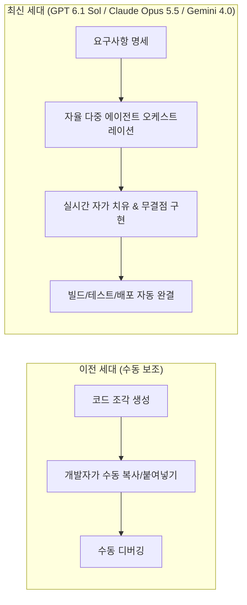

# 🧠 LLM (대규모 언어 모델) 가이드

> [!IMPORTANT]
> **📅 최신 공식 릴리즈 실시간 동기화 (2026년 10월 최신 기준)**  
> 본 가이드는 글로벌 빅테크 및 연구소의 **공식 릴리즈 노트와 최신 플래그십 발표**를 바탕으로 전면 업데이트되었습니다.  
> * **OpenAI**: [GPT 6.1 Sol](/docs/llm/gpt-6-1-sol) (솔라리스 심층 추론, 1,200만 컨텍스트 최신 GA)
> * **Anthropic**: [Claude Opus 5.5](/docs/llm/claude-opus-5-5) · [Claude Sonnet 5.5](/docs/llm/claude-sonnet-5-5) · [Claude Haiku 5.5](/docs/llm/claude-haiku-5-5) (공식 릴리스 노트 동기화)
> * **Google DeepMind**: [Gemini 4.0](/docs/llm/gemini-4-0) (1,600만 인피니트 윈도우 GA) · [Gemini 3.8 Flash](/docs/llm/gemini-3-8-flash)
> * **xAI**: [Grok 4.7](/docs/llm/grok-4-7) (Expert/Heavy 모드 및 xAI Skills 최신 플래그십)
> * **Alibaba**: [Qwen 3.8](/docs/llm/qwen-3-8) (2.4조 파라미터 초대형 모델, Token Plan)
> * **Upstage**: [Solar Pro 4](/docs/llm/solar-pro-4.md) (512K/128K 실무 완주형 에이전트, OfficeVerse)
> * **Moonshot AI**: [Kimi K3](/docs/llm/kimi-k3) (Agent Swarm 군집 추론 & Kimi Work v3.2.17)

인공지능 기술은 **GPT 6.1 Sol**, **Claude Opus 5.5**, **Gemini 4.0**, **Grok 4.7**, **Solar Pro 4**를 필두로, 단순한 대화형 어시스턴트를 넘어 스스로 요구사항을 분석하고 도구를 실행하며 결과물(보고서·코드·스프레드시트)까지 직접 완주하는 **완전 자율 에이전트(Autonomous Agentic AI)** 시대로 완전히 도약했습니다.

---

## 🧭 주요 빅테크별 공식 최신 라인업 요약

| 개발사 (Lab) | 👑 최상위 플래그십 | ⚡ 엔지니어링 주력 / 실시간 | 🧠 심층 추론 / CoT 특화 | 🔓 온디바이스 / 경량 |
| :--- | :--- | :--- | :--- | :--- |
| **OpenAI** | **[GPT 6.1 Sol](/docs/llm/gpt-6-1-sol)** (12M 컨텍스트) | **[GPT-6](/docs/llm/gpt-6.md)** / **GPT-4.5** | **o3** / **[o3-mini](/docs/llm/o3-mini.md)** | GPT-4o mini |
| **Anthropic** | **[Claude Opus 5.5](/docs/llm/claude-opus-5-5)** (SWE 91.4%) | **[Claude Sonnet 5.5](/docs/llm/claude-sonnet-5-5)** | **[Claude 3.7 Sonnet](/docs/llm/claude-3-7-sonnet.md)** | **[Claude Haiku 5.5](/docs/llm/claude-haiku-5-5.md)** (1M 컨텍스트) |
| **Google** | **[Gemini 4.0](/docs/llm/gemini-4-0)** (5M 무손실) | **[Gemini 3.8 Flash](/docs/llm/gemini-3-8-flash.md)** (Sub-100ms) | **Gemini 2.0 Pro** | **[Gemma 3](/docs/llm/gemma-3.md)** (Open Weights) |
| **xAI** | **[Grok 4.7](/docs/llm/grok-4-7.md)** (Expert/Heavy 모드) | **[Grok 4.6](/docs/llm/grok-4-6.md)** | **Grok 4.7 (Thinks hard)** | Grok Skills |
| **DeepSeek** | **[DeepSeek-V4](/docs/llm/deepseek-v4.md)** (1T MoE 오픈) | **[DeepSeek-V3](/docs/llm/deepseek-v3.md)** (671B MoE) | **[DeepSeek-R1](/docs/llm/deepseek-r1.md)** (RL 추론 1위) | **[DeepSeek Coder V3](/docs/llm/deepseek-coder-v3.md)** |
| **Meta AI** | **[Llama 5.1](/docs/llm/llama-5-1.md)** (2M 컨텍스트) | **[Llama 3.3 70B](/docs/llm/llama-3-3-70b.md)** | **Llama 5-Reasoning** | Llama 5-8B (Mobile) |
| **알리바바** | **[Qwen 3.8](/docs/llm/qwen-3-8.md)** (2.4조 파라미터) | **[Qwen 2.5-Max](/docs/llm/qwen-2-5-max.md)** | **[Qwen 2.5-Coder](/docs/llm/qwen-2-5-coder.md)** | Qwen 2.5-7B |
| **문샷 AI** | **[Kimi K3](/docs/llm/kimi-k3.md)** (Agent Swarm) | **[Kimi k1.5](/docs/llm/kimi-k1-5.md)** | **Kimi K2 Thinking** | Kimi K2.7 Code |
| **네이버** | **[HyperCLOVA X 3](/docs/llm/hyperclova-x-3.md)** | HyperCLOVA X Turbo | HyperCLOVA X Legal/Gov | HyperCLOVA X Mobile |
| **업스테이지** | **[Solar Pro 4](/docs/llm/solar-pro-4.md)** (실무 완주 에이전트) | **[Solar 3](/docs/llm/solar-3.md)** | **Solar Pro 4 (Reasoning Effort)** | **Solar Mini 4** (3B) |

---

## 1. 최신 세대 LLM 패러다임의 3대 혁신 ⚡



### 🌟 3대 핵심 패러다임

1. **완전 자율형 소프트웨어 엔지니어링 (Autonomous SWE Agent)**
   - **GPT 6.1 Sol**과 **Claude Opus 5.5**는 기획 문서나 GitHub 이슈 하나만으로 저장소 전체 구조를 파악하고, 멀티파일 코드를 생성하며, 테스트와 배포까지 전 과정을 인간의 개입 없이 자율 완결합니다.

2. **초대용량 컨텍스트 윈도우 & 실시간 옴니 멀티모달**
   - **Gemini 4.0**(1,600만 토큰 인피니트 윈도우), **GPT 6.1 Sol**(1,200만 토큰), **Claude Opus 5.5**(100만 토큰, 128k 단일 출력), **Solar Pro 4**(512K 컨텍스트, 128K 출력), **Gemini 3.8 Flash**(초저지연 100만 토큰)는 수십 년 치의 사내 레거시 코드와 로그 데이터를 단 한 번의 요청에 담아 분석할 수 있는 대용량 컨텍스트를 지원합니다.
   - 40~50ms 미만의 초저지연으로 음성, 4K/8K 비디오, 화면 조작을 실시간 양방향 스트리밍으로 수행합니다.

3. **1조 파라미터(1T) 오픈소스 MoE의 대중화**
   - **DeepSeek-V4**와 **Llama 5.1**을 통해 상용 최고급 성능을 사내 온프레미스(On-Premise) 환경에서 초저비용으로 프라이빗하게 호스팅할 수 있습니다.

---

## 2. 전 세계를 선도하는 최신 세대 LLM 총람 🚀

### 👑 1. 글로벌 최상위 플래그십 모델 (Global Flagship Tier)

| 모델명 (Model) | 개발사 | 컨텍스트 | 주요 특징 및 핵심 혁신 |
| :--- | :--- | :--- | :--- |
| **[GPT 6.1 Sol](/docs/llm/gpt-6-1-sol.md) 🚀** | OpenAI | **1,200만 토큰 (12M)** | **OpenAI 공식 최신 플래그십 (2026.10 GA)**. Sol 자율 에이전틱 아키텍처, 실시간 가상 샌드박스 자가 치유 디버깅, <40ms 옴니 스트리밍 |
| **[Claude Opus 5.5](/docs/llm/claude-opus-5-5.md) 🏆** | Anthropic | **100만 토큰 (1M, 128k 출력)** | **Anthropic 공식 최상위 플래그십 (2026.09.22 출시)**. SWE-bench 91.4% 압도적 1위, 항상 켜져 있는 적응형 사고(effort 제어), $4/$20 MTok 가성비 혁신 |
| **[Claude Sonnet 5.5](/docs/llm/claude-sonnet-5-5.md) ⚡** | Anthropic | **100만 토큰 (1M)** | **Anthropic 최신 엔지니어링 표준 (2026.09.28 출시)**. 프롬프트 캐시 읽기 $0.10/MTok(50% 인하), 보존된 사고(Preserved Thinking) |
| **[Gemini 4.0](/docs/llm/gemini-4-0.md) 🌟** | Google | **500만 토큰 (5M)** | **Google 공식 최신 플래그십 (2026.10 GA)**. TPU v6e 슈퍼클러스터 훈련, 5M 컨텍스트 100% 무손실 검색, Omni-Perception 4.0 |
| **[Gemini 3.8 Flash](/docs/llm/gemini-3-8-flash.md) ⚡** | Google | **100만 토큰 (1M)** | **Google 최신 실시간 초고속**. Sub-100ms 초저지연 양방향 옴니 멀티모달, 에이전트 루프 및 대량 배치 가성비 극대화 |
| **[Grok 4.7](/docs/llm/grok-4-7.md) ✨** | xAI | **100만 토큰 (1M)** | **xAI 공식 최신 플래그십 (GA)**. grok.com Expert(Thinks hard) 및 Heavy(Team of Experts) 모드 기본 구동, 네이티브 슬라이드/스프레드시트/문서 생성, xAI Skills 전면 지원 |
| **[Grok 4.6](/docs/llm/grok-4-6.md)** | xAI | **50만 토큰 (500K)** | 20만 H100/H200 Colossus 슈퍼컴퓨터 훈련, Big Brain Think 심층 추론, DeepSearch 2.0 (이전 세대 플래그십) |
| **[DeepSeek-V4](/docs/llm/deepseek-v4.md) 🔓** | DeepSeek | **100만 토큰** | **오픈소스 최신 플래그십 (2026.10 GA)**. 1조(1T) 파라미터 MoE (토큰당 48B 활성화), MLA 2.0으로 메모리 95% 절감, MIT 라이선스 |
| **[Llama 5.1](/docs/llm/llama-5-1.md) 🔓** | Meta | **200만 토큰** | **Meta 최신 플래그십 (2026.10 GA)**. 8B 온디바이스부터 1T 데이터센터용까지, 프라이빗 엔터프라이즈 사내 구축 글로벌 표준 |

---

### 🇨🇳 2. 중국 대표 최신 세대 LLM 진영 (China Leading AI Models)

현재 전 세계 AI 업계와 오픈소스 생태계에서 가장 폭발적인 인기를 끌며 실무 개발자들에게 가장 많이 쓰이는 중국의 핵심 파운데이션 및 특화 모델 라인업입니다.

| 모델명 (Model) | 개발사 / 연구진 | 컨텍스트 | 오픈소스 여부 | 핵심 강점 및 실무 활용도 |
| :--- | :--- | :--- | :--- | :--- |
| **[Qwen 3.8](/docs/llm/qwen-3-8.md) 👑** | 알리바바 (Alibaba) | **100만 토큰** | 클라우드 & 오픈 예정 | **2.4조(2.4T) 파라미터 초대형 최신 플래그십**. Qwen3.8-Max-Preview, Token Plan, Qoder/QoderWork 에이전트 동시 6~8개 병렬 실행 |
| **[Kimi K3](/docs/llm/kimi-k3.md) 🌕** | 문샷 AI (Moonshot) | **200만 토큰 (2M)** | 상용 서비스 & API | **문샷 AI 차세대 플래그십 (Kimi Work v3.2.17)**. Agent Swarm 다중 에이전트 자율 협업, Notion/Lark 실시간 공동 작성 |
| **[DeepSeek-V3](/docs/llm/deepseek-v3.md) 🌟** | 딥시크 (DeepSeek) | **128K** | **완전 오픈 가중치** | 671B MoE(토큰당 37B 활성화), Multi-head Latent Attention(MLA)으로 KV 캐시 메모리 90% 절감, FP8 초저비용 훈련 혁신 |
| **[DeepSeek-R1](/docs/llm/deepseek-r1.md) 🧠** | 딥시크 (DeepSeek) | **128K** | **완전 오픈 가중치** | 순수 대규모 강화학습(RL) 기반 사고 과정(CoT) 공개 추론 모델, o1급 수학·코딩 추론력을 오픈소스로 실현 |
| **[Qwen 2.5-Max](/docs/llm/qwen-2-5-max.md)** | 알리바바 (Alibaba) | **128K** | 상용 클라우드 API | 알리바바 2.5세대 상용 플래그십. 18조 토큰 학습, MMLU 89.7%, 고난도 비즈니스 추론 및 29개 다국어 지원 |
| **[Qwen 2.5-Coder](/docs/llm/qwen-2-5-coder.md) 💻** | 알리바바 (Alibaba) | **128K** | **오픈 가중치 (32B/7B)** | 전 세계 오픈소스 코딩 모델 1위(EvalPlus/HumanEval 92.7%), VS Code·Cursor·Ollama 로컬 코딩 필수 표준 |
| **[Kimi k1.5](/docs/llm/kimi-k1-5.md)** | 문샷 AI (Moonshot) | **200만 토큰 (2M)** | 상용 서비스 & API | 200만 토큰 무손실 롱 컨텍스트, 멀티모달 강화학습 기반 심층 추론 아카이브 |
| **[GLM-4-Plus](/docs/llm/glm-4-plus.md) 🎓** | 즈푸 AI (Zhipu / 칭화대) | **128K** | 상용 API & 일부 오픈 | 칭화대 연구진 설립, GLM 양방향 하이브리드 아키텍처, 실시간 음성(GLM-4-Voice) 및 All-Tools 에이전트 |
| **[MiniMax-Text-01](/docs/llm/minimax-text-01.md) ⚡** | 미니맥스 (MiniMax) | **400만 토큰 (4M)** | 상용 API | **400만 토큰 초고속 컨텍스트**, Linear Attention 기반으로 책 1,000만 단어와 코드 수만 줄을 1초에 분석 |
| **[Yi-Lightning](/docs/llm/yi-lightning.md) ⚡** | 01.AI (리카이푸) | **128K** | 상용 API & 오픈 | LMSYS 챗봇 아레나 글로벌 최상위권 달성, 초당 수백 토큰의 압도적인 생성 속도와 파격적인 가성비 |
| **[Baichuan 4](/docs/llm/baichuan-4.md) 🏥** | 백천지능 (Baichuan) | **128K** | 상용 API | 소고우 창업자 왕샤오촨 설립, 실시간 검색 증강(RAG) 및 국가 의사시험 수석급 의료·금융 전문 버티컬 특화 |
| **[Step-2](/docs/llm/step-2.md) 🪐** | 지웨스단 (StepFun) | **128K** | 상용 API | 전 MS 부사장 장창 설립, 1조(1T) 파라미터 MoE 기반 언어/초고해상도 시각(Step-1V) 멀티모달 |
| **[Hunyuan-Large](/docs/llm/hunyuan-large.md) 🐧** | 텐센트 (Tencent) | **256K** | **오픈 가중치 (389B)** | 텐센트 389B 대규모 MoE(토큰당 52B 활성화), 256K 컨텍스트, 위챗·게임 엔터테인먼트 생태계 검증 |

---

### 🇰🇷 3. 대한민국 대표 최신 세대 파운데이션 모델 (Domestic Leaders)

| 모델명 (Model) | 개발사 | 컨텍스트 | 주요 특징 및 핵심 혁신 |
| :--- | :--- | :--- | :--- |
| **[Solar Pro 4](/docs/llm/solar-pro-4.md) 🇰🇷** | 업스테이지 | **512K (128K 출력)** | **업스테이지 공식 최신 플래그십 에이전트**. 실무 완주형 에이전트, Reasoning Effort 조절, OfficeVerse & Ko-GDPval 기반 Excel/Word/PPT 생성, 할루시네이션 방지 |
| **[Solar 3](/docs/llm/solar-3.md)** | 업스테이지 | **128K** | DUS 3.0 기반 고효율 모델, Document AI & OCR 특화 아카이브 |
| **[HyperCLOVA X 3](/docs/llm/hyperclova-x-3.md) 🇰🇷** | 네이버 | **20만 토큰** | **네이버 최신 3세대 플래그십**. 한국어 문화·사법·행정·금융 규제 이해 국내 1위, 초고속 한국어 토크나이저 3.0 탑재 |
| **[EXAONE 3.5](/docs/llm/exaone-3-5.md)** | LG AI연구원 | **32K** | 한국어 벤치마크 최상위 및 전문 산업(특허, 바이오, 화학) 도메인 특화 오픈 파운데이션 모델 |

---

### ⚡ 4. 고속 추론 및 검증된 실무 명작 모델 (Established High-Performers)

| 모델명 (Model) | 개발사 | 컨텍스트 | 주요 특징 |
| :--- | :--- | :--- | :--- |
| **[Claude 3.7 Sonnet](/docs/llm/claude-3-7-sonnet.md)** | Anthropic | 200K | 하이브리드 추론의 문을 연 명작 모델. Thinking Budget 조절 및 터미널 Claude Code 지원 |
| **[o3-mini](/docs/llm/o3-mini.md)** | OpenAI | 200K | STEM·수학·알고리즘 고속 추론 및 Reasoning Effort(Low/Med/High) 제어 모델 |
| **[DeepSeek-R1](/docs/llm/deepseek-r1.md)** | DeepSeek | 128K | 순수 강화학습(RL) 기반으로 스스로 사고하는 오픈소스 심층 추론 모델 |
| **[Qwen 2.5-Coder](/docs/llm/qwen-2-5-coder.md)** | Alibaba | 128K | 5.5조 개 코드 토큰으로 학습된 실무 코딩 전용 오픈 가중치 모델 |
| **[GPT-4.5](/docs/llm/gpt-4-5.md)** | OpenAI | 128K | 초대형 파운데이션 지식과 감성 지능(EQ), 최저 환각률을 자랑하는 지식 모델 |
| **[Gemini 2.0 Flash](/docs/llm/gemini-2-0-flash.md)** | Google | 1M | 정식 GA 초저지연 실시간 오디오/비디오 스트리밍 모델 |
| **[Llama 3.3 70B](/docs/llm/llama-3-3-70b.md)** | Meta | 128K | 405B급 성능을 70B로 압축한 엔터프라이즈 사내 구축 완성형 모델 |

---

## 3. 최신 공인 벤치마크 총괄 비교 📊

| 모델명 | SWE-bench Verified (실무 코딩) | AIME (고난도 수학) | GPQA Diamond (박사급 과학) | 컨텍스트 윈도우 |
| :--- | :--- | :--- | :--- | :--- |
| **Claude Opus 5.5 🏆** | **91.4% (전 세계 1위 🏆)** | **93.5%** | **86.4%** | **1,000,000 토큰 (128k 출력)** |
| **GPT 6.1 Sol 🚀** | **89.6%** | **96.2% (수학 1위)** | **87.0% (과학 1위)** | **12,000,000 토큰 (12M)** |
| **Claude Sonnet 5.5 ⚡**| **88.2%** | **91.0%** | **83.5%** | **1,000,000 토큰** |
| **Gemini 4.0 🌟** | **87.2%** | **94.0%** | **85.8%** | **16,000,000 토큰 (16M)** |
| **Qwen 3.8 (2.4T) 👑** | **86.5%** | **95.2%** | **84.0%** | **1,000,000 토큰 (초대형)** |
| **Grok 4.7 ✨** | **81.5%** | **94.8%** | **84.2%** | **1,000,000 토큰 (1M)** |
| **Solar Pro 4 🇰🇷** | **78.2%** | **89.5%** | **80.5%** | **512,000 토큰 (128k 출력)** |
| **Grok 4.6** | 76.8% | 92.6% | 82.4% | 500,000 토큰 (500K) |
| **Kimi K3 🌕** | **75.8%** | **91.2%** | **81.0%** | **2,000,000 토큰 (Swarm)** |
| **DeepSeek-V4 (오픈소스)** | 74.5% | 88.0% | 78.5% | 1,000,000 토큰 |
| **Gemini 3.8 Flash ⚡** | 74.0% | 84.5% | 76.8% | 1,000,000 토큰 (초저지연 <100ms) |
| **Qwen 2.5-Coder-32B 💻** | 73.5% (HumanEval 92.7%)| 79.8% | 68.5% | 128,000 토큰 (로컬 최강) |
| **Llama 5.1 (오픈소스)** | 72.0% | 85.0% | 76.0% | 2,000,000 토큰 |
| **Claude 3.7 Sonnet** | 70.3% | 84.5% | 65.0% | 200,000 토큰 |
| **o3-mini** | 67.2% | 87.3% | 79.7% | 200,000 토큰 |

---

## 4. 실전 개발자를 위한 최신 API 호출 코드 💻

### 1) OpenAI GPT 6.1 Sol (Autonomous Agentic Mode)
```typescript
import OpenAI from 'openai';

const openai = new OpenAI({ apiKey: process.env.OPENAI_API_KEY });

const response = await openai.chat.completions.create({
  model: 'gpt-6.1-sol',
  // ⚡ GPT 6.1 Sol 자율 엔지니어링 에이전트 활성화
  agent_mode: 'full_autonomous',
  context_optimization: 'zero_loss',
  messages: [
    {
      role: 'user',
      content: '기존 Express 백엔드를 Nest.js 마이크로서비스로 전면 리팩토링하고, 단위/통합 테스트와 Dockerfile까지 완벽히 생성해 줘.'
    }
  ]
});

console.log(response.choices[0].message.content);
```

### 2) Anthropic Claude Opus 5.5 (Adaptive Thinking with effort parameter)
```typescript
import Anthropic from '@anthropic-ai/sdk';

const anthropic = new Anthropic({ apiKey: process.env.ANTHROPIC_API_KEY });

const response = await anthropic.messages.create({
  model: 'claude-opus-5-5',
  max_tokens: 32000,
  // ⚡ Claude Opus 5.5 적응형 사고 깊이 조절 (공식 effort 매개변수)
  effort: 'high',
  messages: [
    {
      role: 'user',
      content: '대규모 분산 카프카 클러스터 환경에서 메시지 유실 없는 정확히 한 번(Exactly-once) 처리 파이프라인 코드를 작성해 줘.'
    }
  ]
});

console.log(response.content);
```

### 3) Google Gemini 4.0 (Live Web Grounding)
```typescript
import { GoogleGenAI } from '@google/genai';

const ai = new GoogleGenAI({ apiKey: process.env.GEMINI_API_KEY });

const response = await ai.models.generateContent({
  model: 'gemini-4.0-pro',
  contents: [
    { role: 'user', parts: [{ text: 'Kubernetes 멀티 클러스터 서비스 메시 아키텍처 패턴을 분석해 줘.' }] }
  ],
  config: {
    temperature: 0.1,
    maxOutputTokens: 16384,
    // Google Search 실시간 웹 그라운딩 & 교차 검증 활성화
    tools: [{ googleSearch: {} }]
  }
});

console.log(response.text);
```

### 4) xAI Grok 4.7 (Expert / Heavy Mode with Skills)
```typescript
import OpenAI from 'openai';

const xai = new OpenAI({
  apiKey: process.env.XAI_API_KEY,
  baseURL: 'https://api.x.ai/v1'
});

const grokRes = await xai.chat.completions.create({
  model: 'grok-4-7',
  messages: [
    { role: 'system', content: 'xAI 최신 플래그십 Grok 4.7입니다. 사실에 입각한 심층 분석과 실시간 코딩을 지원합니다.' },
    { role: 'user', content: '분산 환경에서의 멱등성 보장 패턴과 Kafka Exactly-once 스트림 설계를 제시해줘.' }
  ],
  temperature: 0.2
});

console.log(grokRes.choices[0].message.content);
```

### 5) Upstage Solar Pro 4 (Agentic Workflow with Reasoning Effort)
```typescript
import OpenAI from 'openai';

const upstage = new OpenAI({
  apiKey: process.env.UPSTAGE_API_KEY,
  baseURL: 'https://api.upstage.ai/v1/solar'
});

const solarRes = await upstage.chat.completions.create({
  model: 'solar-pro-4',
  messages: [
    { role: 'system', content: 'Solar Pro 4 실무 에이전트입니다. 근거 없는 내용은 억측하지 않고 확인 불가로 명시합니다.' },
    { role: 'user', content: '첨부된 용역계약서 파일 3건을 교차 검토하여 지체상금 조항의 상충 여부를 정리해줘.' }
  ],
  // @ts-ignore
  reasoning_effort: 'high',
  temperature: 0.1
});

console.log(solarRes.choices[0].message.content);
```

---

## 5. 🌐 주요 LLM 공식 사이트, 개발자 콘솔 및 모델 허브 바로가기 🔗

각 인공지능 연구기관 및 빅테크 기업의 공식 웹사이트, API 대시보드, 웹 플레이그라운드, 오픈소스 모델 다운로드 허브입니다.

| 생태계 / 개발사 | 공식 사이트 & 웹 서비스 | 개발자 API 콘솔 & 플레이그라운드 | 오픈소스 모델 가중치 / 문서 |
| :--- | :--- | :--- | :--- |
| **OpenAI** | [ChatGPT](https://chatgpt.com) | [OpenAI Platform](https://platform.openai.com) | [OpenAI Documentation](https://platform.openai.com/docs) |
| **Anthropic** | [Claude.ai](https://claude.ai) | [Anthropic Console](https://console.anthropic.com) | [Anthropic Release Notes](https://platform.claude.com/docs/ko/release-notes/overview) |
| **Google DeepMind** | [Gemini](https://gemini.google.com) | [Google AI Studio](https://aistudio.google.com) | [Vertex AI / Kaggle Models](https://cloud.google.com/vertex-ai) |
| **DeepSeek (딥시크)** | [DeepSeek Chat](https://chat.deepseek.com) | [DeepSeek Platform](https://platform.deepseek.com) | [DeepSeek HuggingFace](https://huggingface.co/deepseek-ai) |
| **xAI** | [Grok on X](https://grok.com) | [xAI Console](https://console.x.ai) | [Grok Release Notes](https://grok.com/release-notes) |
| **Meta AI** | [Meta AI](https://www.meta.ai) | [Meta for Developers](https://ai.meta.com/llama) | [Llama HuggingFace](https://huggingface.co/meta-llama) |
| **Alibaba Cloud** | [Tongyi Qianwen](https://tongyi.aliyun.com) | [Alibaba Cloud Model Studio](https://bailian.console.aliyun.com) | [Qwen HuggingFace](https://huggingface.co/Qwen) |
| **Moonshot (문샷 AI)** | [Kimi.ai](https://kimi.ai) | [Moonshot Open Platform](https://platform.moonshot.cn) | [Kimi Work Release Notes](https://www.kimi.ai/ko/help/kimi-work/release-notes) |
| **Zhipu AI (즈푸)** | [ChatGLM](https://chatglm.cn) | [Zhipu AI Open Platform (BigModel)](https://open.bigmodel.cn) | [THUDM GitHub](https://github.com/THUDM) |
| **MiniMax (미니맥스)** | [MiniMax](https://www.minimaxi.com) | [MiniMax Open Platform](https://platform.minimaxi.com) | [MiniMax Docs](https://platform.minimaxi.com/document) |
| **01.AI (리카이푸)** | [Wanzhi (만지)](https://www.wanzhi.com) | [01.AI Platform](https://platform.lingyiwanwu.com) | [01.AI HuggingFace](https://huggingface.co/01-ai) |
| **Tencent (텐센트)** | [Hunyuan](https://hunyuan.tencent.com) | [Tencent Cloud Hunyuan](https://cloud.tencent.com/product/hunyuan) | [Hunyuan GitHub](https://github.com/Tencent/Tencent-Hunyuan-Large) |
| **네이버 (NAVER)** | [CLOVA X](https://clovax.naver.com) | [NAVER Cloud CLOVA Studio](https://clovastudio.ncloud.com) | [Naver Cloud Platform Docs](https://guide.ncloud-docs.com) |
| **업스테이지 (Upstage)** | [Upstage.ai](https://www.upstage.ai) | [Upstage Console](https://console.upstage.ai) | [Upstage Blog](https://www.upstage.ai/blog/ko/solar-pro-4) |
| **글로벌 리더보드** | [LMSYS Chatbot Arena](https://chat.lmsys.org) | [Open LLM Leaderboard](https://huggingface.co/spaces/open-llm-leaderboard/open_llm_leaderboard) | [SWE-bench Leaderboard](https://www.swebench.com) |

---

## 6. 최신 세대 모델 선택 가이드 (Quick Matrix)

```
┌─────────────────────────────────────────────────────────────┐
│ 🎯 어떤 작업을 수행하시나요?                                │
├─────────────────────────────────────────────────────────────┤
│ 1. 최고의 자율 코딩 & 아키텍처 재설계 👉 Claude Opus 5.5 / GPT 6.1 Sol│
│ 2. 일상적 고성능 개발 & 최적 가성비   👉 Claude Sonnet 5.5 ($0.10/MTok)│
│ 3. 1,600만 토큰 인피니트 분석 & TPU   👉 Gemini 4.0          │
│ 4. 2.4조 파라미터 초대형 프런티어     👉 Qwen 3.8 (Alibaba)  │
│ 5. 1,200만 토큰 초대용량 레포지토리   👉 GPT 6.1 Sol         │
│ 6. 실시간 X 리서치 & 오피스 생성      👉 Grok 4.7 (Expert/Heavy)│
│ 7. 실무 문서/Excel/PPT 및 터미널 완주 👉 Solar Pro 4 (512K/128K)│
│ 8. 멀티 에이전트 자율 군집 & 협업 작성👉 Kimi K3 (Agent Swarm)│
│ 9. 로컬 무료 오픈소스 최강 코딩      👉 Qwen 2.5-Coder / DeepSeek-V3│
│ 10. 400만 토큰 초고속 문서 1초 분석   👉 MiniMax-Text-01      │
│ 11. 실시간 음성/영상 옴니 스트리밍    👉 Gemini 3.8 Flash / Claude Haiku 5.5│
│ 12. 사내 온프레미스 최강 오픈소스 MoE 👉 DeepSeek-V4 / Llama 5.1│
│ 13. 순수 강화학습 심층 오픈 추론      👉 DeepSeek-R1          │
│ 14. 국내 공공/금융 규제 및 한국어 특화👉 HyperCLOVA X 3 / Solar Pro 4│
└─────────────────────────────────────────────────────────────┘
```

---

[🔙 홈 화면으로 돌아가기](/)

