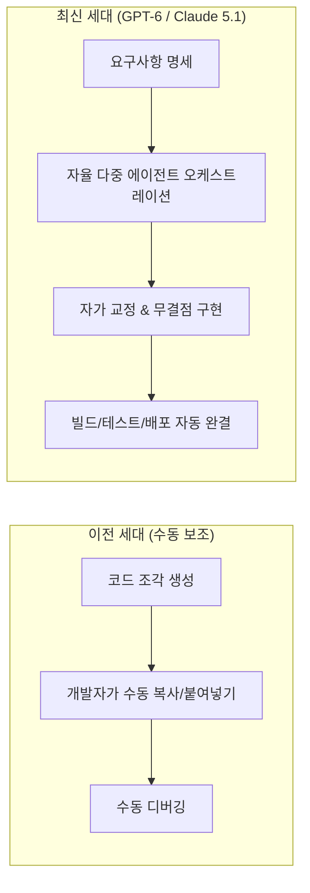

# 🧠 LLM (대규모 언어 모델) 가이드 (최신판)

인공지능 기술은 **GPT-6**과 **Claude 5.1**을 필두로, 단순한 보조 도구를 넘어 스스로 기획하고 코드를 작성하며 인프라를 운영하는 **완전 자율 에이전트(Autonomous Agentic AI)** 시대로 완전히 도약했습니다.

본 가이드는 현재 시장을 주도하고 있는 **GPT-6**, **Claude 5.1**, **Gemini 3.1 Pro & 3.8 Flash**, **DeepSeek-V4**, **Grok 5**, **Llama 5.1** 등 최신 세대 플래그십 모델부터 실무 벤치마크, API 활용 팁까지 개발자를 위한 핵심 정보를 총망라했습니다.

---

## 1. 최신 세대 LLM 패러다임의 3대 혁신 ⚡



### 🌟 3대 핵심 패러다임

1. **완전 자율형 소프트웨어 엔지니어링 (Autonomous SWE Agent)**
   - **GPT-6**과 **Claude 5.1**은 GitHub 이슈나 기획 문서 하나만으로 저장소 전체 구조를 분석하고, 멀티파일 코드를 생성하며, 테스트와 배포까지 전 과정을 인간의 개입 없이 자율 완결합니다.

2. **초대용량 컨텍스트 윈도우 & 실시간 옴니 멀티모달**
   - **GPT-6**(1,000만 토큰)과 **Gemini 3.1 Pro**(400만 토큰), **Gemini 3.8 Flash**(초저지연 100만 토큰)는 수년 치의 사내 레거시 코드와 로그 데이터를 단 한 번의 요청에 담아 분석할 수 있는 대용량 컨텍스트를 지원합니다.
   - 50~100ms 미만의 초저지연으로 음성, 4K 비디오, 화면 조작을 실시간 양방향 스트리밍으로 수행합니다.

3. **1조 파라미터(1T) 오픈소스 MoE의 대중화**
   - **DeepSeek-V4**와 **Llama 5.1**을 통해 상용 최고급 성능을 사내 온프레미스(On-Premise) 환경에서 초저비용으로 프라이빗하게 호스팅할 수 있습니다.

---

## 2. 전 세계를 선도하는 최신 세대 LLM 총람 🚀

### 👑 1. 글로벌 최상위 플래그십 모델 (Global Flagship Tier)

| 모델명 (Model) | 개발사 | 컨텍스트 | 주요 특징 및 핵심 혁신 |
| :--- | :--- | :--- | :--- |
| **[GPT-6](/docs/llm/gpt-6.md) 🚀** | OpenAI | **1,000만 토큰 (10M)** | **OpenAI 최신 플래그십**. 프로젝트 전 과정 자율 소프트웨어 엔지니어링, Zero-Loss 뉴럴 메모리, <50ms 실시간 옴니 멀티모달 |
| **[Claude 5.1](/docs/llm/claude-5-1.md) 🏆** | Anthropic | **100만 토큰 (1M)** | **Anthropic 최신 플래그십**. SWE-bench Verified 88.5% 압도적 1위, Extended Thinking 4.0, OS/IDE 완전 제어 Computer Use 3.0 |
| **[Gemini 3.1 Pro](/docs/llm/gemini-3-1-pro.md) ⚡** | Google | **400만 토큰 (4M)** | **Google 최신 플래그십**. 4M 컨텍스트 100% 무손실 검색, Google Search 실시간 웹 그라운딩 & 자체 검증, TPU v6 최적화 |
| **[Gemini 3.8 Flash](/docs/llm/gemini-3-8-flash.md) ⚡** | Google | **100만 토큰 (1M)** | **Google 최신 실시간 초고속**. Sub-100ms 초저지연 양방향 옴니 멀티모달, 에이전트 루프 및 대량 배치 가성비 극대화 |
| **[Grok 4.6](/docs/llm/grok-4-6.md) ✨** | xAI | **50만 토큰 (500K)** | **xAI 최신 플래그십**. 20만 H100/H200 Colossus 슈퍼컴퓨터 훈련, Big Brain Think 심층 추론, DeepSearch 2.0 실시간 X 결합 |
| **[DeepSeek-V4](/docs/llm/deepseek-v4.md) 🌟** | DeepSeek | **100만 토큰** | **오픈소스 최신 플래그십**. 1조(1T) 파라미터 MoE (토큰당 48B 활성화), MLA 2.0으로 메모리 95% 절감, MIT 라이선스 |
| **[Llama 5.1](/docs/llm/llama-5-1.md) 🔓** | Meta | **200만 토큰** | **Meta 최신 플래그십**. 8B 온디바이스부터 1T 데이터센터용까지, 프라이빗 엔터프라이즈 사내 구축 글로벌 표준 |

---

### 🇨🇳 2. 중국 대표 최신 세대 LLM 진영 (China Leading AI Models)
현재 전 세계 AI 업계와 오픈소스 생태계에서 가장 폭발적인 인기를 끌며 실무 개발자들에게 가장 많이 쓰이는 중국의 핵심 파운데이션 및 특화 모델 라인업입니다.

| 모델명 (Model) | 개발사 / 연구진 | 컨텍스트 | 오픈소스 여부 | 핵심 강점 및 실무 활용도 |
| :--- | :--- | :--- | :--- | :--- |
| **[DeepSeek-V3](/docs/llm/deepseek-v3.md) 🌟** | 딥시크 (DeepSeek) | **128K** | **완전 오픈 가중치** | 671B MoE(토큰당 37B 활성화), Multi-head Latent Attention(MLA)으로 KV 캐시 메모리 90% 절감, FP8 초저비용 훈련 혁신 |
| **[DeepSeek-R1](/docs/llm/deepseek-r1.md) 🧠** | 딥시크 (DeepSeek) | **128K** | **완전 오픈 가중치** | 순수 대규모 강화학습(RL) 기반 사고 과정(CoT) 공개 추론 모델, o1급 수학·코딩 추론력을 오픈소스로 실현 |
| **[Qwen 2.5-Max](/docs/llm/qwen-2-5-max.md) 👑** | 알리바바 (Alibaba) | **128K** | 상용 클라우드 API | 알리바바의 최상위 플래그십. 18조 토큰 학습, MMLU 89.7%, 고난도 비즈니스 추론 및 29개 다국어 지원 |
| **[Qwen 2.5-Coder](/docs/llm/qwen-2-5-coder.md) 💻** | 알리바바 (Alibaba) | **128K** | **오픈 가중치 (32B/7B)** | 전 세계 오픈소스 코딩 모델 1위(EvalPlus/HumanEval 92.7%), VS Code·Cursor·Ollama 로컬 코딩 필수 표준 |
| **[Kimi k1.5](/docs/llm/kimi-k1-5.md) 🌕** | 문샷 AI (Moonshot) | **200만 토큰 (2M)** | 상용 서비스 & API | 200만 토큰 무손실 롱 컨텍스트, 멀티모달 강화학습 기반 심층 추론, 중국 내 최고 인기 리서치 AI |
| **[GLM-4-Plus](/docs/llm/glm-4-plus.md) 🎓** | 즈푸 AI (Zhipu / 칭화대) | **128K** | 상용 API & 일부 오픈 | 칭화대 연구진 설립, GLM 양방향 하이브리드 아키텍처, 실시간 음성(GLM-4-Voice) 및 All-Tools 에이전트 |
| **[MiniMax-Text-01](/docs/llm/minimax-text-01.md) ⚡** | 미니맥스 (MiniMax) | **400만 토큰 (4M)** | 상용 API | **400만 토큰 초고속 컨텍스트**, Linear Attention 기반으로 책 1,000만 단어와 코드 수만 줄을 1초에 분석 |
| **[Yi-Lightning](/docs/llm/yi-lightning.md) ⚡** | 01.AI (리카이푸) | **128K** | 상용 API & 오픈 | LMSYS 챗봇 아레나 글로벌 최상위권 달성, 초당 수백 토큰의 압도적인 생성 속도와 파격적인 가성비 |
| **[Baichuan 4](/docs/llm/baichuan-4.md) 🏥** | 백천지능 (Baichuan) | **128K** | 상용 API | 소고우 창업자 왕샤오촨 설립, 실시간 검색 증강(RAG) 및 국가 의사시험 수석급 의료·금융 전문 버티컬 특화 |
| **[Step-2](/docs/llm/step-2.md) 🪐** | 지웨스단 (StepFun) | **128K** | 상용 API | 전 MS 부사장 장창 설립, 1조(1T) 파라미터 MoE 기반 언어/초고해상도 시각(Step-1V) 멀티모달 |
| **[Hunyuan-Large](/docs/llm/hunyuan-large.md) 🐧** | 텐센트 (Tencent) | **256K** | **오픈 가중치 (389B)** | 텐센트 389B 대규모 MoE(토큰당 52B 활성화), 256K 컨텍스트, 위챗·게임 엔터테인먼트 생태계 검증 |

---

### 🇰🇷 3. 대한민국 대표 최신 세대 파운데이션 모델 (Domestic Leaders)

| 모델명 (Model) | 개발사 | 컨텍스트 | 주요 특징 및 핵심 혁신 |
| :--- | :--- | :--- | :--- |
| **[HyperCLOVA X 3](/docs/llm/hyperclova-x-3.md) 🇰🇷** | 네이버 | **20만 토큰** | **네이버 최신 3세대 플래그십**. 한국어 문화·사법·행정·금융 규제 이해 국내 1위, 초고속 한국어 토크나이저 3.0 탑재 |
| **[Solar 3](/docs/llm/solar-3.md) 🇰🇷** | 업스테이지 | **128K** | **업스테이지 최신 플래그십**. DUS 3.0 기반으로 단일 GPU에서도 빅테크급 성능 구현, 고정밀 Document AI & OCR 특화 |
| **[EXAONE 3.5](/docs/llm/exaone-3-5.md)** | LG AI연구원 | **32K** | 한국어 벤치마크 최상위 및 전문 산업(특허, 바이오, 화학) 도메인 특화 오픈 파운데이션 모델 |

---

### ⚡ 3. 고속 추론 및 검증된 실무 명작 모델 (Established High-Performers)

| 모델명 (Model) | 개발사 | 컨텍스트 | 주요 특징 |
| :--- | :--- | :--- | :--- |
| **[Claude 3.7 Sonnet](/docs/llm/claude-3-7-sonnet.md)** | Anthropic | 200K | 하이브리드 추론의 문을 연 명작 모델. Thinking Budget 조절 및 터미널 Claude Code 지원 |
| **[o3-mini](/docs/llm/o3-mini.md)** | OpenAI | 200K | STEM·수학·알고리즘 고속 추론 및 Reasoning Effort(Low/Med/High) 제어 모델 |
| **[DeepSeek-R1](/docs/llm/deepseek-r1.md)** | DeepSeek | 128K | 순수 강화학습(RL) 기반으로 스스로 사고하는 오픈소스 심층 추론 모델 |
| **[Qwen 2.5-Coder](/docs/llm/qwen-2-5-coder.md)** | Alibaba | 128K | 5.5조 개 코드 토큰으로 학습된 실무 코딩 전용 오픈 가중치 모델 |
| **[GPT-4.5](/docs/llm/gpt-4-5.md)** | OpenAI | 128K | 초대형 파운데이션 지식과 감성 지능(EQ), 최저 환각률을 자랑하는 지식 모델 |
| **[Gemini 2.0 Flash](/docs/llm/gemini-2-0-flash.md)** | Google | 1M | 정식 GA 초저지연 실시간 오디오/비디오 스트리밍 모델 |
| **[Llama 3.3 70B](/docs/llm/llama-3-3-70b.md)** | Meta | 128K | 405B급 성능을 70B로 압축한 엔터프라이즈 사내 구축 완성형 모델 |

---

## 3. 최신 공인 벤치마크 총괄 비교 (최신 세대 기준) 📊

| 모델명 | SWE-bench Verified (실무 코딩) | AIME (고난도 수학) | GPQA Diamond (박사급 과학) | 컨텍스트 윈도우 |
| :--- | :--- | :--- | :--- | :--- |
| **Claude 5.1 🏆** | **88.5% (1위 🏆)** | **92.0%** | **82.5%** | **1,000,000 토큰** |
| **GPT-6 🚀** | **86.4%** | **94.8%** | **84.2%** | **10,000,000 토큰 (10M)** |
| **Grok 4.6 ✨** | **76.8%** | **92.6%** | **82.4%** | **500,000 토큰 (500K)** |
| **Gemini 3.1 Pro ⚡** | **78.4%** | **89.2%** | **81.0%** | **4,000,000 토큰 (4M)** |
| **Gemini 3.8 Flash ⚡** | **74.0%** | **84.5%** | **76.8%** | **1,000,000 토큰 (초저지연 <100ms)** |
| **DeepSeek-V4 (오픈소스)** | **74.5%** | **88.0%** | **78.5%** | **1,000,000 토큰** |
| **Qwen 2.5-Coder-32B 💻** | **73.5% (HumanEval 92.7%)**| **79.8%** | **68.5%** | **128,000 토큰 (로컬 최강)** |
| **Llama 5.1 (오픈소스)** | **72.0%** | **85.0%** | **76.0%** | **2,000,000 토큰** |
| **Claude 3.7 Sonnet** | 70.3% | 84.5% | 65.0% | 200,000 토큰 |
| **o3-mini** | 67.2% | 87.3% | 79.7% | 200,000 토큰 |

---

## 4. 실전 개발자를 위한 최신 API 호출 코드 💻

### 1) OpenAI GPT-6 (Autonomous Agentic Mode)
```typescript
import OpenAI from 'openai';

const openai = new OpenAI({ apiKey: process.env.OPENAI_API_KEY });

const response = await openai.chat.completions.create({
  model: 'gpt-6',
  // ⚡ GPT-6 자율 소프트웨어 엔지니어링 에이전트 활성화
  agent_mode: 'full_autonomous',
  context_optimization: 'zero_loss',
  messages: [
    {
      role: 'user',
      content: '기존 Express 백엔드를 Nest.js 마이크로서비스로 전면 리팩토링하고, 단위/통합 테스트와 Dockerfile까지 완벽히 생성해 줘.'
    }
  ]
});

console.log(response.choices[0].message.content);
```

### 2) Anthropic Claude 5.1 (Extended Thinking 4.0)
```typescript
import Anthropic from '@anthropic-ai/sdk';

const anthropic = new Anthropic({ apiKey: process.env.ANTHROPIC_API_KEY });

const response = await anthropic.messages.create({
  model: 'claude-5-1-sonnet',
  max_tokens: 32000,
  // ⚡ Claude 5.1 다중 경로 자가 교정 추론 예산
  thinking: {
    type: 'enabled',
    budget_tokens: 8192
  },
  messages: [
    {
      role: 'user',
      content: '대규모 분산 카프카 클러스터 환경에서 메시지 유실 없는 정확히 한 번(Exactly-once) 처리 파이프라인 코드를 작성해 줘.'
    }
  ]
});

console.log(response.content);
```

---

## 5. 최신 세대 모델 선택 가이드 (Quick Matrix)

```
┌─────────────────────────────────────────────────────────────┐
│ 🎯 어떤 작업을 수행하시나요?                                │
├─────────────────────────────────────────────────────────────┤
│ 1. 최고의 자율 코딩 & 아키텍처 재설계 👉 Claude 5.1 / GPT-6  │
│ 2. 로컬 무료 오픈소스 최강 코딩      👉 Qwen 2.5-Coder / DeepSeek-V3│
│ 3. 초대용량 레포지토리 & 무손실 분석  👉 GPT-6 / Gemini 3.1 Pro│
│ 4. 400만 토큰 초고속 문서 1초 분석   👉 MiniMax-Text-01      │
│ 5. 실시간 음성/영상 옴니 스트리밍      👉 Gemini 3.8 Flash / GLM-4-Voice│
│ 6. 실시간 X 리서치 & 팩트 과학 추론  👉 Grok 4.6              │
│ 7. 사내 온프레미스 최강 오픈소스 MoE   👉 DeepSeek-V4 / Llama 5.1│
│ 8. 중국어 리서치 & 200만 롱컨텍스트  👉 Kimi k1.5            │
│ 9. 국내 공공/금융 규제 및 한국어 최적화👉 HyperCLOVA X 3 / Solar 3│
└─────────────────────────────────────────────────────────────┘
```

---

[🔙 홈 화면으로 돌아가기](/)
