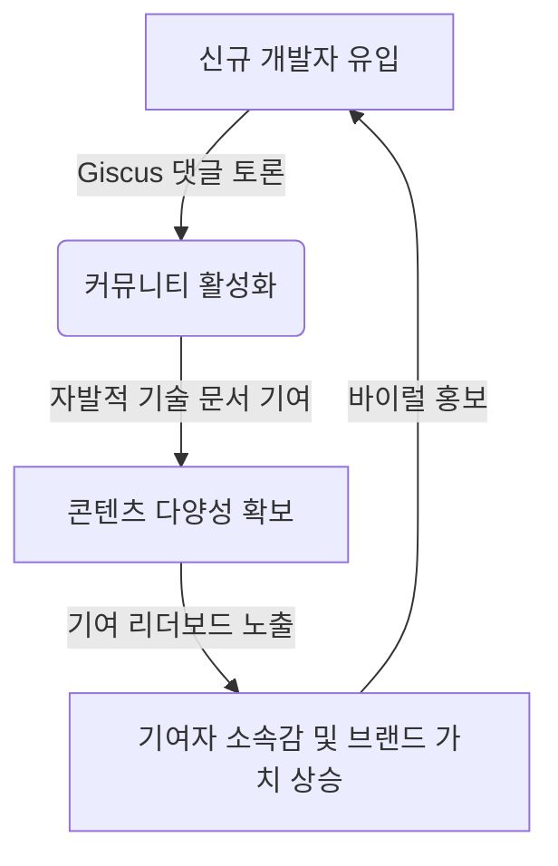

# 💡 개발자 지식DB 활성화 및 고도화 제안서

본 제안서는 **개발자를 위한 지식DB** 정적 사이트(VitePress 기반)의 한계를 극복하고, 개발자들의 자발적인 참여와 커뮤니티 활성화를 유도하기 위한 구체적인 기능 고도화 방안을 제시합니다.

---

## 1. 핵심 활성화 전략 및 제안 기능

### 1.1. GitHub Discussion 기반 댓글 시스템 (Giscus/Utterances) 도입
* **개요**: 모든 지식 콘텐츠 및 가이드라인 하단에 실시간 댓글/토론 영역을 추가합니다.
* **상세**: 
  * 별도의 데이터베이스나 회원가입 서버 없이, GitHub 계정만 있으면 댓글을 작성할 수 있는 오픈소스 도구(Giscus)를 연동합니다.
  * 개발자들이 문서 오류를 지적하거나 추가 의견을 편하게 나눌 수 있어 콘텐츠의 품질이 자율적으로 개선됩니다.
* **효과**: 개발자 간의 지식 교류 공간 형성, 스팸 없는 클린한 토론 유도.

### 1.2. 실시간 컨트리뷰터(기여한 개발자) 리더보드 구현
* **개요**: GitHub API를 연동하여 프로젝트 빌드 시 혹은 런타임에 기여율이 높은 개발자들의 프로필을 홈 화면에 노출합니다.
* **상세**: 
  * 커밋 수, PR 병합 수, 이슈 제보 수를 기준으로 기여한 사람들의 GitHub 프로필 카드를 자동 생성합니다.
  * "내가 이 지식DB를 함께 만들어가고 있다"는 성취감(오픈소스 기여 경험)을 부여합니다.
* **효과**: 개발자들의 자발적인 PR(Pull Request) 참여 유도 및 오픈소스 기여 브랜딩 제공.

### 1.3. 실시간 북마크 추천 및 업보트(Upvote) 투표 시스템
* **개요**: 유용한 개발 링크나 팁을 개발자가 직접 등록하고 다른 이들의 추천을 받는 기능입니다.
* **상세**: 
  * Supabase(PostgreSQL 기반 무료 티어) 또는 Firebase 등 서버리스 DB를 연동하여 가벼운 동적 기능을 구현합니다.
  * 개발자가 유용한 아티클을 제안하면, 타 개발자들이 추천(Upvote)을 눌러 순위가 실시간 반영되는 'Reddit/Hacker News' 스타일의 미니 게시판을 첫 화면 하단에 구축합니다.
* **효과**: 최신 기술 아티클과 리소스의 실시간 자발적 아카이빙.

### 1.4. 인터랙티브 '오늘의 개발 퀴즈 & 팁' 위젯
* **개요**: 사이트 접속 시 매일 변경되거나 랜덤으로 출제되는 프론트엔드/백엔드/인프라 기초 퀴즈 위젯입니다.
* **상세**:
  * 1분 미만으로 풀 수 있는 객관식 개발자 퀴즈(예: JS 동기/비동기 문제, DB 격리 수준 등)를 제공합니다.
  * 문제를 풀면 정답 해설과 함께 관련 지식 콘텐츠(해당 문서) 링크로 바로 이동할 수 있게 설계합니다.
* **효과**: 재방문율(Retention) 극대화 및 지식 탐색 유도.

### 1.5. 오프라인 아카이빙을 위한 PDF/Markdown 다운로드 기능
* **개요**: 사이트의 방대한 지식 정보를 개별 개발자가 소장할 수 있도록 PDF 또는 마크다운 파일로 원클릭 다운로드하는 기능을 제공합니다.
* **상세**:
  * 특정 프로그래밍 언어 가이드라인이나 보안 가이드라인 전체를 하나의 깔끔한 문서 포맷으로 추출합니다.
* **효과**: 실무나 사내 세미나 자료로 인용하도록 유도하여 외부 공유 및 바이럴 효과 창출.

---

## 2. 기술적 구현 타당성 (Feasibility)

* 본 사이트는 정적 사이트 제네레이터(SSG)인 **VitePress**로 빌드되어 서버 유지 비용이 $0(무료)에 가깝다는 큰 장점이 있습니다.
* 제안된 고도화 기능들은 이 구조적 장점을 파괴하지 않는 선에서 구현 가능합니다.
  * **Giscus**: 클라이언트 사이드 스크립트 삽입만으로 동작 (서버 불필요)
  * **기여도 대시보드**: GitHub REST API를 Vue 컴포넌트 내에서 호출 (서버 불필요)
  * **투표 및 추천 시스템**: Supabase Client SDK를 활용해 프론트엔드에서 데이터베이스 직접 연결 (서버리스 구현)

---

## 3. 기대 효과 요약

---
[← 홈 화면으로 돌아가기](/)
