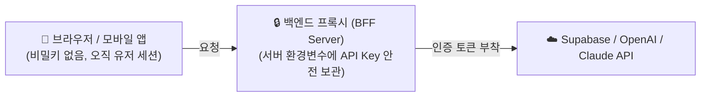

# 🛡️ 보안 지침 가이드 (SECURITY.md)

이 문서는 시스템을 구축하고 운영할 때 **외부 해킹, 역공학(Reverse Engineering), 데이터 유출**로부터 사용자의 개인정보와 시스템을 안전하게 보호하기 위한 **공식 보안 지침**입니다.

초보자 및 교육자도 바로 이해하고 복사하여 적용할 수 있도록 **생략 없는 완전한 코드 예제와 상세한 한글 설명**을 함께 제공합니다.

---

## 📌 1. 핵심 보안 4대 원칙

1. **DB 전달 전 암호화 필수 (Encryption Before Ingestion)**:
   - 개인정보(이름, 학생 정보, 연락처 등)와 비밀번호는 데이터베이스에 전달되거나 저장되기 전에 반드시 암호화 또는 해싱되어야 합니다.
2. **제로 트러스트 및 최소 권한 (Zero Trust & Least Privilege)**:
   - 모든 사용자 입력값과 외부 통신은 신뢰하지 않으며, 서버 및 데이터베이스 권한은 최소한으로만 부여합니다.
3. **외부 해킹 및 역공학 방어 (Anti-Hacking & Anti-Reverse Engineering)**:
   - 프론트엔드 코드 난독화, 디버깅 소스맵 차단, 비밀키(API Key) 서버 격리(BFF 아키텍처)를 의무화합니다.
4. **Supabase 쿼리 파일 관리 규칙 준수**:
   - 모든 마이그레이션 및 보안 쿼리는 `000_` 형태의 순서 번호를 붙여 `supabase/migrations/` 폴더에 일원화하여 관리합니다.

---

## 🔐 2. 개인정보 및 비밀번호 강력 암호화 로직

사용자의 개인정보(학생 정보, 전화번호, 이메일 등)와 비밀번호는 성격에 따라 암호화 방식이 완전히 달라야 합니다.

| 데이터 종류 | 추천 암호화 방식 | 복호화 가능 여부 | 적용 시점 |
| :--- | :--- | :--- | :--- |
| **비밀번호 (Password)** | **Argon2id** 또는 **bcrypt (cost 12+)** | 복호화 불가능 (단방향 해시) | 회원가입/비밀번호 변경 시 DB 전송 전 |
| **개인정보/학생정보 (PII)** | **AES-256-GCM** | 복호화 가능 (대칭키 양방향 암호화) | DB Insert/Update 전 백엔드 비즈니스 로직 |

---

### 2.1 [완전한 코드] Node.js / TypeScript 기반 개인정보 AES-256-GCM 암호화 모듈

아래 코드는 생략 없이 그대로 복사하여 사용할 수 있는 완전한 암호화/복호화 유틸리티입니다.

```typescript
// 파일 위치: src/utils/encryption.ts
// 설명: 사용자의 민감한 개인정보(학생 정보, 연락처 등)를 데이터베이스에 저장하기 전에 
//       강력한 AES-256-GCM 알고리즘으로 양방향 암호화하는 유틸리티 모듈입니다.

import crypto from 'crypto';

// 1. 암호화 알고리즘 정의: AES-256-GCM (인증 암호화 지원, 변조 탐지 가능)
const ALGORITHM = 'aes-256-gcm';

// 2. 초기화 벡터(IV) 길이: GCM 표준 12바이트 권장
const IV_LENGTH = 12;

// 3. 환경 변수에서 32바이트(256비트) 마스터 암호화 키를 불러옵니다.
// 주의: .env 파일에 반드시 ENCRYPTION_MASTER_KEY가 64자리 16진수로 설정되어 있어야 합니다.
const MASTER_KEY_HEX = process.env.ENCRYPTION_MASTER_KEY;

if (!MASTER_KEY_HEX || MASTER_KEY_HEX.length !== 64) {
  throw new Error('보안 경고: 32바이트(64자 16진수) 길이의 ENCRYPTION_MASTER_KEY가 .env에 설정되어야 합니다.');
}

const MASTER_KEY = Buffer.from(MASTER_KEY_HEX, 'hex');

// 암호화 결과 반환 인터페이스
export interface EncryptedData {
  ciphertext: string; // 암호화된 본문 (Hex 문자열)
  iv: string;         // 초기화 벡터 (Hex 문자열)
  authTag: string;    // 위변조 검증용 인증 태그 (Hex 문자열)
}

/**
 * [개인정보 암호화 함수]
 * 데이터베이스에 학생 정보나 연락처를 전달하기 전에 호출합니다.
 * @param plainText 평문 텍스트 (예: 학생 성명, 전화번호, 주민등록번호 등)
 * @returns EncryptedData 객체
 */
export function encryptSensitiveData(plainText: string): EncryptedData {
  // 매 암호화마다 예측 불가능한 암호학적으로 안전한 랜덤 IV 생성
  const iv = crypto.randomBytes(IV_LENGTH);

  // AES-256-GCM 암호화 객체 생성
  const cipher = crypto.createCipheriv(ALGORITHM, MASTER_KEY, iv);

  // 텍스트 암호화 수행
  let encrypted = cipher.update(plainText, 'utf8', 'hex');
  encrypted += cipher.final('hex');

  // GCM 인증 태그 획득 (데이터 위변조 방지용)
  const authTag = cipher.getAuthTag().toString('hex');

  return {
    ciphertext: encrypted,
    iv: iv.toString('hex'),
    authTag: authTag,
  };
}

/**
 * [개인정보 복호화 함수]
 * 데이터베이스에서 조회한 암호화 데이터를 화면에 표시하거나 사용할 때 호출합니다.
 * @param encryptedData 암호문, IV, AuthTag가 포함된 객체
 * @returns 복호화된 원본 평문 텍스트
 */
export function decryptSensitiveData(encryptedData: EncryptedData): string {
  const iv = Buffer.from(encryptedData.iv, 'hex');
  const authTag = Buffer.from(encryptedData.authTag, 'hex');

  // AES-256-GCM 복호화 객체 생성
  const decipher = crypto.createDecipheriv(ALGORITHM, MASTER_KEY, iv);

  // 인증 태그 설정 (만약 데이터가 1비트라도 위변조되었으면 복호화 시 에러가 발생함)
  decipher.setAuthTag(authTag);

  // 복호화 수행
  let decrypted = decipher.update(encryptedData.ciphertext, 'hex', 'utf8');
  decrypted += decipher.final('utf8');

  return decrypted;
}
```

---

### 2.2 [완전한 코드] 비밀번호 단방향 해싱 (Argon2 / bcrypt) 모듈

비밀번호는 절대 평문이나 복호화 가능한 방식으로 저장해서는 안 됩니다.

```typescript
// 파일 위치: src/utils/password.ts
// 설명: 사용자 비밀번호를 안전하게 단방향 해싱하고 일치 여부를 검증하는 모듈입니다.

import bcrypt from 'bcrypt';

// 해싱 강도(Salt Rounds): 12 이상 권장 (무차별 대입 공격 방어)
const SALT_ROUNDS = 12;

/**
 * [비밀번호 안전 해싱 함수]
 * 회원가입 또는 비밀번호 재설정 시 DB 전달 전에 반드시 실행합니다.
 * @param plainPassword 사용자가 입력한 원래 비밀번호
 * @returns 해싱된 문자열 (Salt가 자동으로 포함됨)
 */
export async function hashPassword(plainPassword: string): Promise<string> {
  if (!plainPassword || plainPassword.length < 8) {
    throw new Error('비밀번호는 최소 8자 이상이어야 합니다.');
  }
  const salt = await bcrypt.genSalt(SALT_ROUNDS);
  const hashedPassword = await bcrypt.hash(plainPassword, salt);
  return hashedPassword;
}

/**
 * [비밀번호 일치 검증 함수]
 * 로그인 시 사용자가 입력한 비밀번호와 DB에 저장된 해시값을 비교합니다.
 * @param plainPassword 로그인 시 입력한 평문 비밀번호
 * @param hashedPassword DB에 저장되어 있는 해시값
 * @returns 일치 여부 (true / false)
 */
export async function verifyPassword(plainPassword: string, hashedPassword: string): Promise<boolean> {
  return await bcrypt.compare(plainPassword, hashedPassword);
}
```

---

## 🛡️ 3. 외부 해킹 및 역공학(Reverse Engineering) 방지 최적화

웹이나 모바일 앱 클라이언트는 누구에게나 코드가 다운로드될 수 있는 취약한 환경입니다. 외부 공격자가 코드를 리버스 엔지니어링하여 내부 로직이나 API 키를 탈취하지 못하도록 다음 조치를 필수로 적용합니다.

### 3.1 BFF(Backend For Frontend) 패턴: 비밀키 클라이언트 노출 원천 차단
- **치명적 위험**: 프론트엔드 React/Vue 코드 내에 `VITE_OPENAI_API_KEY`, `SUPABASE_SERVICE_ROLE_KEY` 등을 넣으면 브라우저의 [소스 코드 보기]나 [Network] 탭을 통해 즉시 털립니다.
- **해결책**: 모든 외부 AI API 호출 및 관리자 DB 접근은 자체 백엔드(BFF) API를 경유하며, 클라이언트는 세션 쿠키나 임시 JWT만 소유합니다.



### 3.2 빌드 최적화: 코드 난독화(Obfuscation) 및 소스맵(SourceMap) 격리
배포 시 `vite.config.ts` 파일에서 프로덕션 소스맵을 끄고 코드를 압축/난독화하여 역공학을 무력화합니다.

```typescript
// 파일 위치: vite.config.ts (빌드 설정 예시)
import { defineConfig } from 'vite';

export default defineConfig({
  build: {
    // 1. 프로덕션 배포 시 원본 코드를 보여주는 소스맵을 절대 생성하지 않음 (역공학 방지)
    sourcemap: false,

    // 2. esbuild 또는 terser를 통한 식별자 압축 및 난독화 활성화
    minify: 'esbuild',

    // 3. 콘솔 로그(console.log, debugger) 프로덕션 빌드에서 자동 제거
    // (개발자 도구로 내부 데이터 확인 차단)
    esbuild: {
      drop: ['console', 'debugger']
    }
  }
});
```

### 3.3 HTTP 보안 헤더 설정
공격자가 악성 사이트에서 우리 사이트를 `<iframe>`으로 띄워 클릭을 가로채거나(Clickjacking), 악성 스크립트를 삽입(XSS)하지 못하도록 방어 헤더를 기본 적용합니다.

```html
<!-- index.html 또는 서버 응답 헤더 -->
<meta http-equiv="X-Content-Type-Options" content="nosniff" />
<meta http-equiv="X-Frame-Options" content="DENY" />
<meta name="referrer" content="strict-origin-when-cross-origin" />
```

---

## 🗄️ 4. Supabase 쿼리 관리 규칙

보안 취약점 중 가장 치명적인 데이터베이스 노출을 방지하기 위해, 모든 데이터베이스 스크립트는 다음 규칙을 준수합니다.

### 4.1 순서 번호 명명 및 디렉토리 위치 규칙
- 모든 SQL 마이그레이션 파일은 반드시 `supabase/migrations/` 디렉토리에 보관합니다.
- 파일명 앞에 반드시 `000_`, `001_`, `002_` 형태의 일련번호를 부여하여 실행 순서를 보장합니다.

```text
📁 supabase/
  └── 📁 migrations/
        ├── 001_create_users_table.sql
        ├── 002_enable_rls_security_policies.sql
        └── 003_add_encrypted_student_info.sql
```

### 4.2 [완전한 코드] Supabase RLS(Row Level Security) 필수 보안 마이그레이션 예제

```sql
-- 파일 위치: supabase/migrations/002_enable_rls_security_policies.sql
-- 설명: 사용자 테이블에 대한 무단 접근을 원천 차단하고,
--       오직 본인 데이터만 읽고 쓸 수 있도록 RLS 정책을 설정합니다.

-- 1. 사용자 테이블에 Row Level Security(행 단위 보안) 강제 활성화
ALTER TABLE public.users ENABLE ROW LEVEL SECURITY;

-- 2. 기존 정책이 있다면 초기화
DROP POLICY IF EXISTS "사용자는 본인 정보만 조회 가능" ON public.users;
DROP POLICY IF EXISTS "사용자는 본인 정보만 수정 가능" ON public.users;

-- 3. 본인 레코드만 SELECT(조회)할 수 있도록 허용하는 보안 정책
CREATE POLICY "사용자는 본인 정보만 조회 가능"
ON public.users
FOR SELECT
TO authenticated
USING (auth.uid() = id);

-- 4. 본인 레코드만 UPDATE(수정)할 수 있도록 허용하는 보안 정책
CREATE POLICY "사용자는 본인 정보만 수정 가능"
ON public.users
FOR UPDATE
TO authenticated
USING (auth.uid() = id)
WITH CHECK (auth.uid() = id);

-- 5. 비인가(익명) 사용자의 모든 접근 원천 거부 확인
```

---

## 📋 5. 개발자 보안 체크리스트 (배포 전 필수 확인)

- [ ] `.env` 파일이 `.gitignore`에 등록되어 GitHub 등 외부에 커밋되지 않는가?
- [ ] 사용자 비밀번호가 평문이 아닌 `Argon2id` 또는 `bcrypt(cost 12+)`로 해싱되었는가?
- [ ] 학생 정보 및 민감한 개인정보가 `AES-256-GCM` 등으로 DB 전달 전 암호화되는가?
- [ ] 클라이언트 빌드 시 `sourcemap: false`로 설정되어 역공학이 차단되었는가?
- [ ] Supabase의 모든 테이블에 `ENABLE ROW LEVEL SECURITY`가 적용되었는가?
- [ ] 모든 SQL 마이그레이션 파일이 `supabase/migrations/` 폴더에 `000_` 번호로 정렬되었는가?

---

[🔙 홈 화면으로 돌아가기](/)
